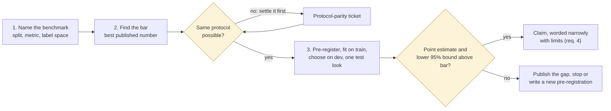

# Goals: earning "state of the art", benchmark by benchmark

Status: draft for owner approval, 2026-10-22. Nothing below has been run unless it says "measured".

## The four requirements, applied

A "state of the art" claim is made per benchmark and split, never in general. For each one:

1. **Name it:** benchmark, split, metric, label space.
2. **Find the bar:** the best published number and the paper or leaderboard it comes from.
3. **Beat it under the same protocol:** pre-registered rule, one test look, a confidence interval.
4. **Say what is not covered:** other benchmarks, other Acts, label quality, licence.

## The bars, as found (2026-10-22, sources linked, not independently re-run)

| Benchmark and split | Metric | Best published | Source | Where Ibid is |
|---|---|---|---|---|
| IL-TUR LSI test (citations masked), 100 IPC labels | macro-F1 | 28.08 LeSICiN | [IL-TUR, ACL 2024](https://aclanthology.org/2024.acl-long.618.pdf), Table 22 | **39.16**, 95% interval 38.4 to 39.8 (measured) |
| Original ILSI test, 13,039 cases | macro-F1 | 64.58 InLegalBERT, hierarchical | [InLegalBERT paper](https://arxiv.org/pdf/2209.06049), Table 3 | 59.56 (measured) |
| Same ILSI test, a newer paper | macro-F1 | 35.5 AoS (best proposed model) | [arXiv 2512.21902](https://arxiv.org/html/2512.21902), Table 8 | 59.56 (measured) |
| ILSIC-Lay test, 836 layperson queries | macro-F1 / micro-F1 | 14.83 / 34.23 GPT-4.1 two-shot; micro 33.19 Gemma-3 fine-tuned | [ILSIC, Jan 2026](https://arxiv.org/html/2602.00881), Table 3 | **never scored** on the full set |
| ILSIC-Multi test, 757 queries | macro-F1 / micro-F1 | 17.01 / 33.95 GPT-4.1 zero-shot | same paper, Table 5 | **never scored** |

Two warnings about the table. The ILSI rows disagree by 29 points (64.58 against 35.5 on the same 13,039-case test), so at least one paper uses a different protocol; until that is settled, the bar for original ILSI is unknown. The IL-TUR leaderboard page lists a single LSI entry, "GPT-3.5 (0-shot)" at 100.00, which cannot be a real score, so the paper's 28.08 is the only usable bar there. Its submission form needs predictions for every test instance, and the Hugging Face copy has 13,019 of the paper's 13,039 test cases.

## Goals

**G1. IL-TUR LSI: make the claim official.** Status: point estimate met. Remaining work: (a) obtain the official evaluation script or the 20 missing test cases, so the leaderboard number is computed by the benchmark's own evaluator and the macro-F1 averaging is confirmed; (b) the leaderboard submission is an outward-facing upload and needs the owner's explicit go. Claim when done: "exceeds the best baseline reported in the IL-TUR paper on LSI". Workflow fit: none for the submission; a ticket for the protocol check.

**G2. Original ILSI: settle the bar, then decide.** Step 1, protocol parity: read both papers' setups and find why one reports 64.58 and the other 35.5 (split, label space, metric averaging, text version). Step 2: if 64.58 stands, close 5 points with the budget InLegalBERT plan (frozen-embedding probe first, stop rule recorded in `strategy.md`). Claim only after both. Workflow fit: step 1 yes (research ticket); step 2 builds the notebook, the owner runs it on Kaggle or Colab.

**G3. ILSIC-Lay and ILSIC-Multi: score what Ibid is for.** The benchmark published in January 2026 for layperson-to-statute queries, where the best published macro-F1 is 14.8 and micro-F1 about 34. Work: confirm the label space and metric (the paper's labels cover more than the IPC offences our layers predict, so a parity rule is needed before scoring), then score each frozen layer (`assoc-nb v2`, `v3`, `linear-lr v1`, `v2`) once on the full Lay test and the Multi test, in the layer ledgers, with intervals. Pre-register first: which label space, which layers, and what counts as beating the bar. Workflow fit: yes, this is a wf-ship slice. Claim when met: "exceeds the published baselines on ILSIC-Lay".

**G4. Coverage matrix and claims ledger.** One table, kept current: Acts covered (IPC, BNS), Acts not covered (BNSS, BSA, CrPC, Evidence Act, Constitution, others), tasks covered (statute identification, lookup, concordance), tasks not (the other seven IL-TUR tasks), each claim linked to its result file and limits. This is what replaces "most complete". Workflow fit: yes.

**G5. Next Acts.** BNSS and BSA with concordances (the replacement of the CrPC and the Evidence Act), as separate slices, each with its own text-fidelity gold set. Workflow fit: yes, but each is large. Not a prerequisite for G1 to G3.

**Not workflow work:** a lawyer review of the gold sets (blocked, owner), and a legal check of the non-commercial training data before any public or commercial use of the learned layers.

## G2 step 1 result (2026-10-22, research agent plus my spot checks)

Why 64.58 and about 28 to 35 disagree on "the same" ILSI test. Found, with the papers' own words (notes in the scratchpad, not committed):

- The InLegalBERT paper never mentions masking citations or entities, and uses the facts as released. IL-TUR's appendix says that released version "contains some unmasked statute citations" (verified by me in IL-TUR App. A.5). So the 64.58 is probably measured on text that still shows section numbers. That is an inference, not verified on the data.
- IL-TUR masks them and reports InLegalBERT+LSTM-Attn at 26.23, while LeSICiN barely moves (28.45 to 28.08). So citations seem to help transformer encoders far more than LeSICiN.
- The metric is a per-label mean of F1 in the LeSICiN code, and the 64.58 is not the harmonic mean of its own macro precision and recall (66.09, computed by me), so it is also a per-label mean. Our macro-F1 is the same kind. The zero-support handling in the InLegalBERT paper is not stated.
- LeSICiN's own results may not reproduce from its repo: the paper says threshold 0.65 and 100 epochs, the released config says 0.51 and 2 epochs (agent's reading of the repo).
- AoS (35.5) says it masks numeric values, yet its Table 7 shows citations such as "Sections 498A, 506B, 324 of IPC" in the text, so its text version is unclear.
- Not found: InLegalBERT's fine-tuning code, its decision threshold, and the SIGIR 2024 paper behind AoS's LeSICiN-B row.

**What this changes.** Two comparison classes, and only like-for-like claims are allowed:

| Class | Published bars | Ibid | Claim allowed |
|---|---|---|---|
| Masked text (IL-TUR LSI) | 28.08 LeSICiN, 26.23 InLegalBERT+LSTM | 39.16 | beats the IL-TUR paper's baselines |
| Original text, citations probably visible | 64.58 InLegalBERT (unreproduced), 35.5 AoS (text version unclear), 28.45 LeSICiN | 59.56 | above LeSICiN and AoS, below InLegalBERT's reported figure; no state-of-the-art claim |

**Recommendation on step 2 (the budget InLegalBERT).** Defer it. The one bar above ours is a figure measured on possibly leaking text, from code I could not find, so closing 5 points to it would not earn a claim. Spend the effort on G3 and G1, and revisit only if the InLegalBERT authors or code settle the setup.

## Order I would run them

1. G3 pre-registration, then G3 scoring (cheapest, most relevant, no downloads: the ILSIC files are already in `data/raw/ilsic`).
2. G2 step 1 in parallel (reading only).
3. G4 after G3, so the ledger holds real numbers.
4. G1 submission when the owner approves it. G2 step 2 and G5 only if G2 step 1 and G3 say they are worth it.

## Wording rules for any claim

Name the benchmark, the split and the metric. Give the interval. Say it is a research comparison against published numbers, not a rerun of their code. Do not say "state of the art" without a benchmark after it, and do not say "complete" at all.
