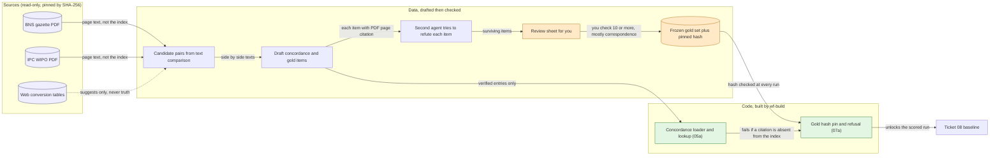

# Plan: concordance (05) and frozen gold set (07)

Status: proposal, needs your decisions below before any ticket changes.

## Why these two are different from 01 to 04

Tickets 01 to 04 and 06 were code with a checkable output. 05 and 07 are mostly data whose truth lives outside the system. If the system generates its own answer key, the score measures agreement with itself. The plan therefore separates the code (which `wf-build` can do) from the data (which needs an independent source and your sign-off).

## How the pieces connect

Orange boxes need you. Green boxes are code an agent can build and test alone.

## Proposed ticket changes

| Now | Becomes | Who |
|---|---|---|
| 05 | 05a: loader, lookup both directions, mapping types, correspondence category, tested on a 4-entry fixture | wf-build |
| 05 | 05b: the real concordance entries | agent drafts, second agent refutes, you sample |
| 07 | 07a: hash pin and refusal when one byte changes, versioned file layout | wf-build |
| 07 | 07b: about 50 gold items with PDF page citations, spot-check record, freeze | agent drafts, you sign off |
| 08 | unchanged, blocked by 05a, 05b, 07a, 07b | wf-build |

05a and 07a are independent of each other and of the data, so they can build in one wave now.

## How the data is kept independent of the system

1. Drafting reads the PDF page text (`pdftotext` per page), never the index or any parser output. Every item records the PDF page of the pinned file and the file's SHA-256, so you can open that page and check the answer yourself.
2. A different agent then tries to refute each item from the same pages, defaulting to refuted if unsure. Items that survive go on your sheet.
3. The 21 existing draft items stay as test fixtures. The 8 subsection and 6 section items were checked against the raw PDF, but the 4 chain items and 3 keyword items were derived from system output. They are replaced, not frozen.
4. Proposed mix of about 48 items: section lookup 8, subsection and proviso 10, cross-reference chain 8, IPC to BNS 10, BNS to IPC 8, keyword 4. The 18 concordance items are the correspondence items.

## Decisions needed

1. Concordance scope. I recommend verified entries only: about 60 IPC sections chosen to cover every mapping type and the gold items, each checked, with every other IPC section answering "no verified concordance". The alternative is all 575 IPC sections, which cannot be hand-checked and would put unverified mappings behind a confident lookup.
2. A fifth mapping type. The spec has one-to-one, split, merged and removed. BNS also adds offences with no IPC ancestor (for example organised crime and mob lynching). The BNS to IPC lookup needs a value for those. I recommend adding `new`, plus a line in the CONTEXT.md Concordance entry.
3. Who checks. I recommend you check 12 items: 8 correspondence and 4 others. The ticket says at least 10, majority correspondence. The second-agent refutation is a filter, not a replacement for your check.
4. Which IPC text. The IPC file is the version amended to 2019. Correspondence is about the replaced IPC, so this is probably right, but you should know the pin refers to that version.

## Risks

- Correspondence is a legal judgement, not only a text match. A refuted-by-agent item can still be wrong in a way both agents share. Your sample is the only real check, so a lawyer's review is still needed before publishing any score, as the spec says.
- The web tables disagree with each other. They only suggest candidates. If a candidate and the texts disagree, the texts win and the item goes on your sheet marked contested.
- Page citations are PDF page numbers, not the printed gazette page numbers. The sheet shows both where they differ.

## Order of work

1. You answer the four decisions above.
2. I split the tickets and flip 05a and 07a to ready-for-agent, then run `wf-build`.
3. I write a data workflow (`wf-gold`) for 05b and 07b: draft, refute, then produce the review sheet.
4. You check the sheet.
5. Freeze, pin, commit the gold set, then run ticket 08.
