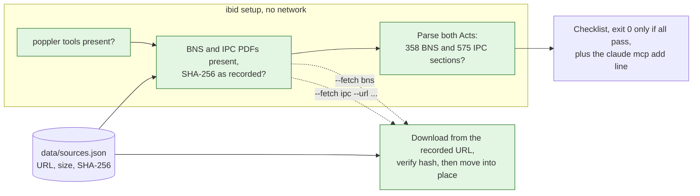

# Slice 10: Set up Ibid on a clean machine

Status: approved 2026-10-18 (owner: "the three slices you suggested are fine, move ahead with them").

## Problem Statement

Nobody but the author can run Ibid today. The README says "fetch the PDFs from the URLs in `data/SOURCES.md` into `data/raw/` and check the hashes", then export two environment variables. A missing poppler tool, a missing PDF, or a PDF of the wrong edition each fail late and with a different message (`error: no such file: ...` is the best case). The IPC source is a WIPO PDF whose link is signed and expires, so it cannot simply be fetched by a script.

## Solution

One command, `ibid setup`, that checks everything the product needs and says exactly what to do about each gap. It makes no network call unless asked. With `--fetch` it downloads a missing source PDF, checks its SHA-256 before putting it in place, and never overwrites a file. At the end it proves the install by parsing both Acts and printing the section counts, and prints the ready-made `claude mcp add` line with this machine's absolute paths.

## Decisions

1. The source of truth for each PDF's URL, byte size and SHA-256 is a committed file `data/sources.json`. A test asserts its hashes equal the ones in `data/SOURCES.md`, so the two cannot drift.
2. Default `ibid setup` is read-only and offline. `--fetch bns|ipc` is the only way it touches the network.
3. A download goes to a temporary file in the same directory, is checked for size (a cap of 200 MB) and SHA-256, and only then renamed into place. A mismatch deletes the temporary file and leaves `data/raw/` as it was. An existing file is never overwritten, even with a wrong hash; setup reports it and stops.
4. The IPC link from WIPO is signed and expires, so `--fetch ipc` requires the user to pass `--url` with a direct PDF URL they obtained. The BNS source (the PRS PDF) has a stable URL and `--fetch bns` uses it.
5. Only `https://` URLs are accepted, plus `http://127.0.0.1` and `http://localhost` so tests can serve a local file.
6. Poppler is detected, never installed. The missing-tool message names the macOS command (`brew install poppler`) and the Debian one (`apt install poppler-utils`).
7. The research data (CAPT table, ILSIC, LeSICiN, AILA) are not part of setup. They are needed only to reproduce the benchmark work, and their licences are non-commercial.

## User stories

1. As a new user, `ibid setup` prints one line per check (each poppler tool, each PDF's presence and hash, each Act's section count) with pass or fail, and exits non-zero if any failed.
2. As a new user, each failed check is followed by the single next action: the install command for a missing tool, the URL and the target path for a missing PDF, or the command to rerun.
3. As a new user, a PDF that exists with a different hash is reported as "present, hash differs", showing both hashes, and is not touched.
4. As a new user, `ibid setup --fetch bns` downloads the BNS PDF into `data/raw/`, verifies the hash and reports success. If the file already exists it refuses and says so.
5. As a new user, `ibid setup --fetch ipc --url <https url>` does the same for the IPC, and without `--url` it explains why the URL must be supplied.
6. As a new user, a download whose bytes do not match the recorded hash, or whose size exceeds the cap, leaves no file behind and says which check failed.
7. As a new user, after all checks pass, setup parses both Acts and prints `BNS 358 sections, IPC 575 sections`, then prints the exact `claude mcp add ibid -- ...` line with absolute paths for this machine.
8. As a new user, `ibid mcp`, `ibid eval` and the other commands that read the PDFs, when a PDF is missing, keep their one-line error and add `run: ibid setup`.
9. As the maintainer, the README Quickstart is replaced by the real sequence: `uv sync`, `uv run ibid setup --fetch bns`, the IPC step with its honest explanation, `uv run ibid setup`.
10. As the maintainer, the index, every result, every pin and the baseline are byte-identical before and after.

## Test seam

The `ibid setup` command, driven by `unittest`. Fixtures are invented tiny PDF-free files and a small manifest passed with `--sources <json>`; network cases use a `http.server` bound to 127.0.0.1 serving a known file. Each new test is run once against known-bad input to see it fail: a download with the wrong hash, a truncated body, an oversized body, an existing file at the target, an `http://` URL to a non-local host.

## Out of scope

- Publishing to PyPI, Docker, and Windows support.
- Installing poppler or `uv` for the user.
- Fetching or documenting the research datasets.
- Any change to parsing, the index, the frozen rule, a gold set or a pinned file.
