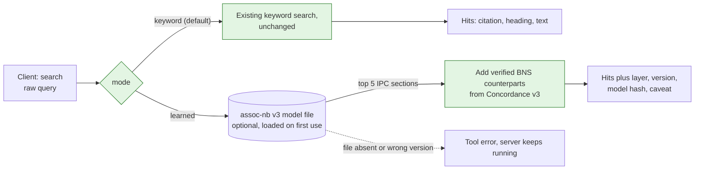

# Slice 11: Offer the learned layer in `search`, and say plainly what story queries can do

Status: approved 2026-10-18 (owner chose option A: an opt-in learned mode on `search`).

## Problem Statement

The MCP `search` tool is keyword search over the raw query. On story-style questions it finds about 5 percent of the charges a lawyer would name. The learned layer `assoc-nb v3` (slice 9, kept as opt-in) finds 58.3 percent of IPC charges on layperson forum posts and 42.9 percent on judgment text, and nothing in the product lets a client reach it. Nothing in the tool descriptions says what either mode can and cannot do.

## Solution

`search` gains an optional `mode`. The default stays `keyword`, byte-identical to today. With `mode: "learned"` the server asks the `assoc-nb v3` model for the top-5 IPC sections for the raw query, adds their verified BNS counterparts from Concordance v3, and returns each with its verbatim text and heading, labelled with the layer name, version and model hash. The model is a file that may be absent; the server never fails to start because of it. The tool descriptions state the measured limits.

## Decisions

1. `mode` is `keyword` (default) or `learned`. Any other value is a tool error naming the two. Omitting it behaves exactly as slice 8 left it, including `adjacent` and `limit`.
2. Learned mode takes the raw query only (ADR 0001 and 0005): no rewriting, no model call, no network. It uses the existing `assoc` code, unchanged.
3. The model path is `--assoc-model` on `ibid mcp`, default `data/assoc-nb-v3.json`. The file is loaded on the first learned call, not at startup. A missing file, an unreadable file, or a header whose layer is not `assoc-nb` version `v3` returns a tool error and leaves keyword mode working.
4. A learned hit carries `citation`, `heading`, `text`, `rank`, and for IPC hits a `bns` list of verified counterpart citations (empty when there is none). The result also carries `layer`, `layer_version`, `model_sha256` and a fixed `caveat` string.
5. `limit` applies to learned mode with a maximum of 5, the layer's k. A larger value is clamped and says so.
6. `adjacent` is not supported in learned mode and is ignored with a note, to keep the two modes' payloads separate.
7. The caveat string and both tool descriptions state: keyword search finds about 5 percent of charges on story-style queries; the learned mode was fitted on court-judgment text and layperson forum posts, covers 140 IPC sections, was measured on labels that are incomplete, and is not legal advice. The figures come from `results/layer-comparison.md` and a test reads them from there, so the text cannot drift from the measurements.
8. `ibid setup` reports the model file as an optional line (present with its hash, or absent with the fit command) and never fails because of it. The README says how to produce the model, and that the training data are gated and non-commercial, so it is a research option and not part of the standard install.

## User stories

1. As a client, `search` with no `mode` returns exactly what it returned before this slice, in the same order, with the same fields, verified against the pre-change behaviour by a test.
2. As a client, `search` with `mode: "learned"` and a model file returns up to 5 IPC hits in the layer's rank order, each with citation, heading, text, rank and a `bns` list.
3. As a client, the learned result carries the layer name, version `v3`, the model hash and the caveat.
4. As a client, for an invented model and query, the learned hits equal what `ibid assoc predict` writes for the same query, in the same order.
5. As a client, with the real model present, the learned top-5 for three items of set v2 equals the committed predictions file `results/layers/assoc-nb-v3-multicharge-v2-predictions.json` (skipped with a clear message when the model file is absent).
6. As a client, `mode: "learned"` with the model file absent returns a tool error that names the file and the fit command, and the next `keyword` call still works.
7. As a client, a model file whose header says another layer or version is refused with a tool error naming both.
8. As a client, `mode: "other"` is a tool error naming the two valid values; `limit: 50` in learned mode returns 5 hits and says it was clamped.
9. As a client, `tools/list` shows `mode` in the `search` schema and the descriptions carry the measured limits, and a test checks the quoted figures against `results/layer-comparison.md`.
10. As the owner, `ibid setup` prints the optional model line and still exits 0 when the model is absent and everything else passes.
11. As the owner, the index, the baseline, the frozen rule, every pinned file and all existing results are byte-identical before and after.

## Test seam

The MCP server's tool calls over stdio (the harness from slices 4 and 5) and `ibid setup`. Fixtures: a tiny invented model fitted with `ibid assoc fit` on invented posts, so the tests run without the real data. Each new test is run once against known-bad input to see it fail: learned mode leaking into the default, a missing model crashing startup, a wrong-version model accepted, a clamped `limit` not reported.

## Out of scope

- Fitting or shipping the model inside the install; any new training or scoring; changing the layer, its vocabulary or its tokenisation.
- Learned mode for the BNS side directly (BNS appears only through verified Concordance entries).
- Combining keyword and learned results into one ranking.
- Any claim of legal accuracy: no lawyer reviewed any label.
