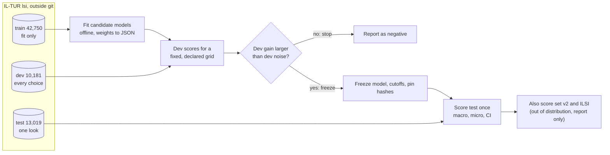

# Slice 13 strategy: beat LeSICiN's macro-F1 without overfitting

Status: signed by the owner 2026-10-22 (D-006). Stage results are appended below. No IL-TUR test score will be looked at until the rules below are signed.

## Target

LeSICiN scores 28.08 macro-F1 on IL-TUR LSI test (IL-TUR paper, Table 22). Our best layer, `assoc-nb v1`, scores 15.5 on the same split (measured 2026-10-22). The gap is 12.6 points.

**What "surpass" means, fixed now:** one test score, point estimate above 28.08, and the lower end of a 95% bootstrap interval over test cases reported next to it. If the interval includes 28.08 the claim is "comparable", not "better". LeSICiN's own figure is a single published run with no interval, so a win by less than the interval is not evidence.

## Why term counts alone will not get there

Macro-F1 averages over 100 labels, so rare sections weigh as much as IPC 302. Naive Bayes with label-frequency priors rarely predicts a rare label. A discriminative model trained per label, with its own cutoff, is the standard fix. Measured on IL-TUR: the smallest label has 272 train and at least 30 dev cases, so a per-label cutoff has real data behind it.

## Design

Stages, each judged on dev only, in this order, stopping when a stage adds less than the dev noise:

1. **Reproduce.** Refit `assoc-nb` on the masked IL-TUR train text and score dev. This separates "text mismatch" from "model limit".
2. **Fix the imbalance.** Drop the label prior or use complement naive Bayes. One scoring change.
3. **Discriminative model.** One-vs-rest logistic regression on tf-idf, with a capped vocabulary. Training is done offline with a throwaway `uv run --with` (as with pyarrow), and only the weights ship, as JSON. Inference stays standard library. This needs an owner decision on ADR 0002 (see below).
4. **Per-label cutoffs.** One cutoff per label, chosen on out-of-fold train scores plus dev, shrunk toward a global cutoff.
5. **Blend** the best two candidates only if both survive stages 1 to 4.

## Overfitting controls

| Risk | Control |
|---|---|
| Tuning on test | Test is scored once, ledgered by file hash. At most one test look for this whole slice. A failed result is published, not retried. |
| Tuning on dev until it looks good | The grid (feature cap, regularisation strength, a handful of cutoffs) is written down before the first fit. Every dev score is reported, not only the best. A gain counts only if it exceeds one standard error from a bootstrap over dev cases. |
| 100 cutoffs overfit to dev | Cutoffs are fitted on out-of-fold train scores, not dev alone, shrunk toward the global value, and only labels with at least 30 dev cases get their own. |
| Capacity | Regularisation and vocabulary cap are chosen on dev from the declared grid. No stacking beyond stage 5. |
| Duplicate leakage | 150 of 13,019 test texts equal a train text. Report the score with and without them. |
| Winning one text style only | After the test look, score set v2 (layperson posts) and the multi-charge set once, report only. A big IL-TUR gain with a set v2 collapse is reported as style overfit. |
| Metric mismatch | Report macro-F1 two ways: ours (zero for an unsupported, unpredicted label) and the paper's definition once confirmed from the IL-TUR evaluation code. |
| Dev-test gap | Report dev minus test macro-F1. A gap over 3 points is flagged as likely overfit even if test passes. |

## Rules carried over

No model in baseline retrieval (ADR 0001). The learned layer stays opt-in (ADR 0005). New layer version means a new ADR, a new pin and its own ledger. The model file is gitignored (CC BY-NC-SA data). The frozen gold sets and the baseline are untouched.

## Owner decisions

1. **Offline training tool.** Stage 3 trains with numpy or scikit-learn outside the package, ships JSON weights, and keeps Ibid's runtime stdlib only. Alternative: pure-Python training, which stays inside ADR 0002 but is too slow at this size (hours per epoch, my estimate, not measured), so stage 3 would be dropped and the ceiling is stages 1, 2 and 4.
2. **Stop rule.** If stage 3 does not clear 28.08 on dev, do we still spend the single test look, or report the dev result and stop?

## Not covered

No lawyer reviewed any label. A higher IL-TUR score does not make answers to layperson questions better. The paper's exact macro-F1 averaging is unconfirmed.

## Stage log

**Stage 1 (dev, 2026-10-22).** `assoc-nb` refit on IL-TUR masked train (`nb-masked`): dev macro-F1 18.28, micro 34.83. v1 on the same dev: 15.15 and 28.96. Test text mismatch explains most of the earlier drop. Dev has 10,181 cases.

**Stage 3 grid, declared before any fit.** One-vs-rest logistic regression (liblinear, L2) on sublinear tf-idf over unigrams, trained offline with scikit-learn; script `.scratch/slice-13/train_linear.py`. Grid: max features {50,000, 150,000} x C {1, 4, 16} = 6 fits. Decision per fit: probability above a single global cutoff, cutoff taken from {0.15, 0.2, 0.25, 0.3, 0.4, 0.5}. All 36 dev scores are reported. A candidate is frozen only if its dev macro-F1 beats `nb-masked` by more than one bootstrap standard error.

**Stage 3 grid result (dev, 2026-10-22).** All 36 scores are in `~/data/il-tur/stage3/grid.log` (outside git). Best per fit: 50k/C4 38.9, 50k/C16 39.0, 150k/C4 38.8, 150k/C16 39.3 macro-F1 (micro 48.4 to 49.5); C=1 reaches only 33.5. Every best cutoff was 0.15, the lowest declared value, and C=16 is the highest, so the optimum may lie outside the grid.

**Amendment A1 (declared before running it).** Add cutoffs {0.05, 0.10} for the two configs 50k/C4 and 150k/C16 only, and a 200-resample bootstrap over dev cases for the standard error. Tie-break, fixed now: among configs within one standard error of the best, freeze the smallest feature cap, then the smallest C. No further grid extension after A1.

**Frozen 2026-10-22 (before the test look).** Candidate `linear-lr v1`: 50,000 features, C=4, global cutoff 0.15, fitted on IL-TUR train only. A1 result: cutoff 0.15 is an interior optimum (0.10: 38.0, 0.20: 37.6 for this config); 150k/C16 reached 39.29 with SE 0.42, the frozen config 38.91, within one SE, so the tie-break picked the smaller one. Stages 2, 4 and 5 were not run: dev already clears 28.08 by about 11 points and the extra stages add complexity the strategy says to avoid once a stage clears the bar. Checks before the look: stdlib prediction equals scikit-learn probabilities (max difference 3e-7, 0 of 30,000 cutoff decisions differ; a mismatched pairing differs by 0.37), `ibid assoc eval` on dev gives macro 38.91 and micro 49.39, equal to scikit-learn's.

**Post-score statistics, declared now.** After the one ledgered test score, the frozen model's test predictions are recomputed without refitting, for: a 1,000-resample bootstrap 95% interval over test cases, and the score without the 150 test texts that equal a train text. These are statistics of the same single look, not a second one.

## Result (2026-10-22)

IL-TUR LSI test, 13,019 cases, scored once (`results/test-ledger-iltur-assoc.json`):

| | Macro-F1 | Micro-F1 |
|---|---|---|
| `linear-lr v1` | **39.16** (95% interval 38.4 to 39.8) | 49.36 (48.9 to 49.8) |
| Without the 150 train-duplicate texts | 39.02 | 49.32 |
| Dev (for the gap) | 38.91 | 49.39 |
| `assoc-nb v1` (before) | 15.46 | 29.15 |
| LeSICiN, IL-TUR paper | 28.08 | not reported |

The target is met: the point estimate is above 28.08 and the lower end of the interval is above it by about 10 points. The dev-test gap is -0.25 (test is higher), far inside the 3-point flag. The paper's exact macro-F1 averaging is unconfirmed; ours is a plain mean over 100 labels and every label has test support, so the two should agree unless the paper averages differently.

Out of distribution, set v2 (layperson posts, report only, scored once per Act): IPC charge recall 44.0 (v3: 58.3, baseline: 4.8), BNS 50.6 (v3: 65.4, baseline: 9.9). The model wins by a wide margin on judgment text and loses to `assoc-nb v3` on layperson text, so it is not a replacement for v3 in the MCP `search` tool. It predicts the non-offence IPC 34 often, which costs precision on set v2. Set v1 was not scored: all 30 of its items are in the IL-TUR train split the model learned from.

Not run: stages 2, 4 and 5 (see the freeze note). Not checked: the paper's averaging; any other seed (liblinear is deterministic, so one fit).
