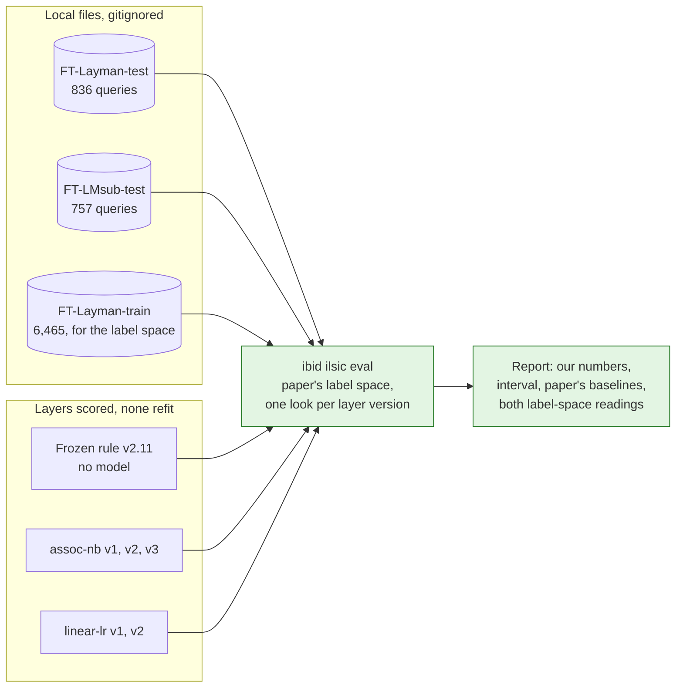

# Slice 14: Score every layer on ILSIC-Lay and ILSIC-Multi

Status: approved 2026-10-22 (owner: "please do both, g3's wf-ship and g2's research", on `.scratch/goals/sota-claims.md`, goal G3). The label-space and metric rules below are defaults taken by the planner and are open to the owner's review.

## Problem Statement

ILSIC (EACL 2026, arXiv 2602.00881) is the published benchmark for what Ibid is meant for: a layperson's question in, Indian statutes out. Its best published numbers are weak: on ILSIC-Lay test (836 queries) macro-F1 14.83 and micro-F1 34.23 (GPT-4.1, two-shot), micro-F1 33.19 for a fine-tuned Gemma-3; on ILSIC-Multi test (757 queries) macro-F1 17.01 and micro-F1 33.95 (GPT-4.1, zero-shot). Ibid has scored only a 30-item subset of the Lay test (set v2), never the full test sets, so it has no claim on this benchmark either way.

## Solution

One command scores any Ibid layer on the full ILSIC-Lay test and the full ILSIC-Multi test with the paper's reading of the metric, once per layer version, and reports the paper's numbers beside ours with a bootstrap interval.

## Decisions

1. **Data.** `data/raw/ilsic/FT-Layman-test.jsonl.xz` (836 queries, the Lay test), `FT-LMsub-test.jsonl.xz` (757, the Multi test, which the paper says is a 399-statute subset of the Lay space), `FT-Layman-train.jsonl.xz` (6,465, used only to fix the label space, never to fit anything in this slice). Rows hold `instruction` (the query) and `answer` (statutes written like "Section 420 of The Indian Penal Code, 1860"). In a git worktree these files are missing: read them from the main checkout by absolute path, `/Users/anmolpokhriyal/projects/ibid/data/raw/ilsic/`.
2. **Primary reading (the paper's), fixed before any score.** The label space is every statute string appearing in the Lay train and test answers, which the paper puts at about 567 (we count 543 from the files; the gap is unexplained). `ibid ilsic eval --space-from` adds the Lay test to the space for the Multi test; the first Multi scores did not use it and used 540 labels. Gold labels are all statutes in the answer, including those from other Acts. A layer predicts IPC sections only, so a gold label outside what it can predict counts as a miss. Macro-F1 is the mean of per-label F1 over the whole label space, with 0 for a label that has no gold and no prediction (the convention already in `bench.py`). Micro-F1 pools all labels. The paper does not state how it treats such labels, so this is our assumption and is stated on every report.
3. **Secondary reading, reported, never substituted.** The same scores over the labels the layer can predict (its vocabulary). A layer that clears a published number only under this reading does not clear it. Say so in the report (decision D-005 of the owner store applies in spirit).
4. **Layers.** The frozen rule v2.11 (no model), `assoc-nb v1`, `v2`, `v3`, and `linear-lr v1`, `v2`. None is refit or changed. Model files: `assoc-nb v1` and `v3` are in the main checkout at `/Users/anmolpokhriyal/projects/ibid/data/assoc-nb-v1.json` and `.../data/assoc-nb-v3.json`; `v2` is not on disk and is rebuilt with the existing `ibid assoc fit --source ilsic-lay` command as ADR 0006 describes; `linear-lr v1` and `v2` are at `/Users/anmolpokhriyal/data/il-tur/models/linear-lr-v1.json` and `linear-lr-v2.json` (gitignored, outside the repo; v1 was trained on the IL-TUR text, v2 on the original ILSI text, neither on ILSIC).
5. **One look.** Each (layer, version, test split) is scored once, in `results/test-ledger-ilsic.json`, keyed by the split file hash. A rescore needs an explicit flag and keeps the first score visible, as in the other ledgers.
6. **Interval.** A 1,000-resample bootstrap over test queries, seed 0, for macro-F1 and micro-F1. Report the 95% interval.
7. **Overlap note.** The Multi test is described as a subset of the Lay label space with its own 757-query test, so the two tests overlap in queries and should not be read as independent evidence. State this in the report.
8. **Baseline numbers beside ours** are copied from the paper's Tables 3 and 5 with their table numbers, and labelled "published, not re-run by us".

## User stories

1. As the owner, `ibid ilsic eval` takes a layer (the frozen rule or a model file), a split (Lay test or Multi test) and the train file for the label space, and writes a results file with macro-F1, micro-F1, macro precision and recall, the label-space size, the layer name, version and model hash, and both readings.
2. As the owner, on an invented fixture the command's scores equal hand-computed values for both readings, including a gold label from another Act that no layer can predict.
3. As the owner, a second scoring of the same layer version on the same test split is refused unless `--rescore-test` is passed, and the ledger keeps the first score.
4. As the owner, the report prints our score, its 95% interval, and the paper's best published numbers for the same split side by side, and states plainly which of the published numbers each layer is above or below under the primary reading.
5. As the owner, the whole scoring needs no network and no model call at scoring time other than the layers' own offline predictions (ADR 0001 and 0005), and the frozen rule runs on the raw query only.
6. As the owner, a new `results/ilsic-report.md` shows all six layers and the frozen rule on both test sets, with the secondary reading in a separate block.
7. As the owner, the baseline, the frozen rule, every pinned file and every committed result are byte-identical before and after.

## Test seam

The `ibid ilsic eval` command through `unittest`, with invented ILSIC-format files (a handful of queries, three Acts, one label unreachable by any layer, one label with no gold) and a tiny invented model. Each new test is run once against known-bad input to see it fail: a gold label from another Act dropped from the label space, a label with no gold counted as 1, a second scoring accepted, a model file of another layer version accepted.

## Out of scope

- Refitting or tuning any layer, changing the frozen rule, a new layer version.
- Any model call, embedding or rewrite of the query (ADR 0001).
- Act coverage beyond the IPC and the BNS, or predictions in any other Act.
- Re-running the paper's baselines.
- Any claim of legal accuracy: the labels are incomplete, no lawyer reviewed them, and the data are CC BY-NC-SA 4.0 research data that stay out of git.
