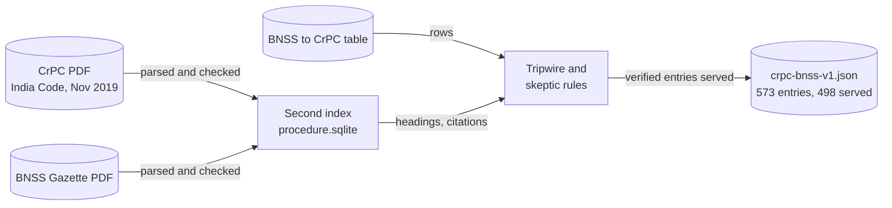

# Slice 15 report: CrPC and BNSS

Every figure below comes from a run on 2026-10-22 of `ibid procedure build` and `ibid concordance from-table --acts crpc-bnss` against the PDFs in `data/raw/`, and is pinned in `docs/claims.md` by `tests/test_claims.py`. The concordance run reproduced `concordance/crpc-bnss-v1.json` byte for byte.

## Sources

The CrPC is the November 2019 India Code revision, taken from the Internet Archive capture of the official file. Later amendments are not in it. The BNSS is the Gazette of 25 December 2023 (PRS copy). The correspondence table is a personal compilation, not an MHA publication.

## Section counts and heading match

| Act | Parsed sections | Against | Heading match |
|---|---|---|---|
| CrPC | 534 | 534 entries in its Arrangement of Sections | 99.06% (529 of 534), floor 98% |
| BNSS | 531 | the published count, 531 | 100.00% (531 of 531), presence only |

The BNSS Gazette prints no Arrangement of Sections, so its headings (margin notes) could not be compared with a second list. The 100% means each section has a heading, not that the heading is right. Neither check confirms the body text.

CrPC heading mismatches (all five printed by the build):

| Citation | Arrangement | Body |
|---|---|---|
| CrPC 208 | Supply of copies of statements and documents to accused in other cases triable by Court of Session. | Supply of copies of statements and documents to accused in other cases triable by Cour t of Session. |
| CrPC 265I | Period of detention undergone by the accused to be set-off against the sentence of imprisonment. | Period of detention undergone by the accused to be set off against the sentence of imprisonment. |
| CrPC 404 | Statement by Metropolitan Magistrate of ground of his decision to be considered by High Court. | Statement by Metropolitan Magistrate of grounds of his decision to be considered by High Court. |
| CrPC 409 | Withdrawal of cases and appeals by Sessions Judges. | Withdrawal of cases and appeals by Session Judge. |
| CrPC 482 | Saving of inherent power of High Court. | Saving of inherent powers of High Court. |

CrPC 208 and 265I differ by a split word and a hyphen. CrPC 404, 409 and 482 differ by a singular or plural word.

## Concordance CrPC to BNSS

573 entries, 498 served (verified), 75 unverified and never served. 544 table rows parsed.

| Type | Verified | Unverified | Total |
|---|---|---|---|
| one-to-one | 488 | 2 | 490 |
| merged | 1 | 0 | 1 |
| new | 9 | 31 | 40 |
| removed | 0 | 42 | 42 |
| split | 0 | 0 | 0 |

Tripwire: the BNSS heading equals a table subject for 89.3% of 531 sections, floor 80%. All 57 mismatches, as printed:

| Citation | BNSS heading | Table subject |
|---|---|---|
| BNSS 4 | Trial of offences under Bharatiya Nyaya Sanhita, 2023 and other laws. | Trial of offences under Bharatiya Nyaya Sanhita and other laws. |
| BNSS 34 | Duty of officers employed in connection with affairs of a village to make certain report. | Duty of officers employed in connection with the affairs of a village to make certain report. |
| BNSS 42 | Protection of members of Armed Forces from arrest. | Protection of members of the Armed Forces from arrest. |
| BNSS 48 | Obligation of person making arrest to inform about arrest, etc., to relative or friend. | Obligation of person making arrest to inform about the arrest, etc , to relative or friend. |
| BNSS 51 | Examination of accused by medical practitioner at request of police officer. | Examination of accused by medical practitioner at the request of police officer. |
| BNSS 62 | Arrest to be made strictly according to Sanhita. | Arrest to be made strictly according to the Sanhita. |
| BNSS 71 | Service of summons on witness. | Service of summons on witness by post. |
| BNSS 93 | Provisions of this Chapter generally applicable to summons and warrants of arrest. | Provisions of this Chapter generally applicable to summonses and warrants of arrest. |
| BNSS 98 | Power to declare certain publications forfeited and to issue search- warrants for same. | Power to declare certain publications forfeited and to issue search-warrants for the same. |
| BNSS 125 | Security for keeping peace on conviction. | Security for keeping the peace on conviction. |
| BNSS 126 | Security for keeping peace in other cases. | Security for keeping the peace in other cases. |
| BNSS 127 | Security for good behaviour from persons disseminating certain matters. | Security for good behaviour from persons disseminating seditious matters. |
| BNSS 170 | Arrest to prevent commission of cognizable offences. | Arrest to prevent the commission of cognizable offences. |
| BNSS 184 | Medical examination of victim of rape. | Medical examination of the victim of rape. |
| BNSS 191 | Complainant and witnesses not to be required to accompany police officer and not to be subject to restraint. | Complainant and witnesses not to be required to accompany police officer and not to be subjected to restraint. |
| BNSS 210 | Cognizance of offences by Magistrate. | Cognizance of offences by Magistrates. |
| BNSS 211 | Transfer on application of accused. | Transfer on application of the accused. |
| BNSS 213 | Cognizance of offences by Court of Session. | Cognizance of offences by Courts of Session. |
| BNSS 217 | Prosecution for offences against State and for criminal conspiracy to commit such offence. | Prosecution for offences against the State and for criminal conspiracy to commit such offence. |
| BNSS 220 | Prosecution of offences under section 85 of Bharatiya Nyaya Sanhita, 2023. | Prosecution of offences under section 498A of the Bharatiya Nyaya Sanhita, 2023. |
| BNSS 224 | Procedure by Magistrate not competent to take cognizance of case. | Procedure by Magistrate not competent to take cognizance of the case. |
| BNSS 230 | Supply to accused of copy of police report and other documents. | Supply to the accused of copy of police report and other documents. |
| BNSS 233 | Procedure to be followed when there is a complaint case and police investigation in respect of same offence. | Procedure to be followed when there is a complaint case and police investigation in respect of the same offence. |
| BNSS 246 | may be charged jointly. | What persons may be charged jointly. |
| BNSS 260 | Procedure in cases instituted under sub-section (2) of section 222. | Procedure in cases instituted under sib-section 2 of section 222. |
| BNSS 284 | Summary trial by Magistrate of second class. | Summary trial by Magistrate of the second class. |
| BNSS 289 | Application of Chapter. | Application of the Chapter. |
| BNSS 292 | Report of mutually satisfactory disposition to be submitted before Court. | Report of the mutually satisfactory disposition to be submitted before the Court. |
| BNSS 293 | Disposal of case. | Disposal of the case. |
| BNSS 294 | Judgment of Court. | Judgment of the Court. |
| BNSS 295 | Finality of judgment. | Finality of the judgment. |
| BNSS 296 | Power of Court in plea bargaining. | Power of the Court in plea bargaining. |
| BNSS 297 | Period of detention undergone by accused to be set off against sentence of imprisonment. | Period of detention undergone by the accused to be set off against the sentence of imprisonment. |
| BNSS 300 | Non- application of Chapter. | Non-application of the Chapter. |
| BNSS 314 | Interpretation of evidence to accused or his advocate. | Interpretation of evidence to accused or his pleader. |
| BNSS 319 | When attendance of witness may be dispensed with and commission an issued. | When attendance of witness may be dispensed with and commission issued. |
| BNSS 328 | Evidence of officers of Mint. | Evidence of officers of the Mint. |
| BNSS 349 | Power of Magistrate to order person to give specimen signatures or handwriting, etc. | Power of Magistrate to order person to give specimen signatures or handwriting. |
| BNSS 351 | Power to examine accused. | Power to examine the accused. |
| BNSS 355 | Provision for inquiries and trial being held in absence of accused in certain cases. | Provision for inquiries and trial being held in the absence of accused in certain cases. |
| BNSS 369 | Release of person of unsound mind pending investigation or trial. | Release of person with mental illness pending investigation or trial. |
| BNSS 396 | Victim compensation scheme. | Victim compensation scheme. Compensation to be in addition to fine under section 65, section 70 and sub- section (1) of section 124 of the Bharatiya Nyaya Sanhita, 2023 [under section 326A or section 376D of Indian Penal Code]. |
| BNSS 404 | Copy of judgment to be given to accused and other persons. | Copy of judgment to be given to the accused and other persons. |
| BNSS 418 | Appeal by State Government against sentence. | Appeal by the State Government against sentence. |
| BNSS 427 | Powers of Appellate Court. | Powers of the Appellate Court. |
| BNSS 430 | Suspension of sentence pending appeal; release of appellant on bail. | Suspension of sentence pending the appeal; release of appellant on bail. |
| BNSS 449 | Withdrawal of cases and appeals by Sessions Judges. | Withdrawal of cases and appeals by Session Judge. |
| BNSS 450 | Withdrawal of cases by Judicial Magistrates. | Withdrawal of cases by Judicial Magistrate. |
| BNSS 455 | Postponement of execution of sentence of death in case of appeal to Supreme Court. | Commutation of sentence of death in case of appeal to Supreme Court. |
| BNSS 456 | Commutation of sentence of death on pregnant woman. | Postponement of capital sentence on pregnant woman. |
| BNSS 468 | Period of detention undergone by accused to be set off against sentence of imprisonment. | Period of detention undergone by the accused to be set off against the sentence of imprisonment. |
| BNSS 479 | Maximum period for which undertrial prisoner can be detained. | Maximum period for which an undertrial prisoner can be detained. |
| BNSS 493 | Procedure in case of insolvency or death of surety or when a bond is forfeited. | Procedure in case of insolvency of death of surety or when a bond is forfeited. |
| BNSS 514 | Bar to taking cognizance after lapse of period of limitation. | Bar to taking cognizance after lapse of the period of limitation. |
| BNSS 515 | Commencement of period of limitation. | Commencement of the period of limitation. |
| BNSS 525 | Cases in which Judge or Magistrate is personally interested. | Case in which Judge or Magistrate is personally interested. |
| BNSS 526 | Practising advocate not to sit as Magistrate in certain Courts. | Practicing advocate not to sit as Magistrate in certain Courts. |

Most are an article ("the"), singular against plural, or spelling. BNSS 455 and 456 look swapped between the two lists (each heading is the other's subject) and are worth a human look.

## Not covered

Schedules and Forms of both Acts, Hindi text, state amendments, CrPC amendments after the November 2019 revision, repealed-section histories. No retrieval accuracy is claimed for these Acts: no keyword gold set exists.

## Review

No lawyer reviewed the text, the headings or the concordance.
