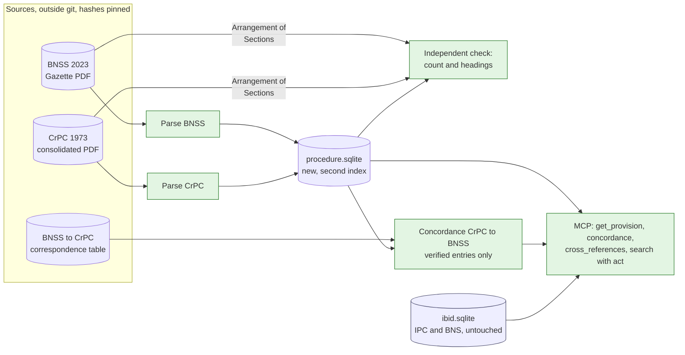

# Slice 15: The Code of Criminal Procedure 1973 and the BNSS 2023, with a verified concordance

Status: approved 2026-10-22 (owner approved the three downloads and the CrPC and BNSS order; D-007). Step 0 is done: the three source files are in `data/raw/` of the main checkout and recorded in `data/SOURCES.md`. In a git worktree they are missing: read them by absolute path from `/Users/anmolpokhriyal/projects/ibid/data/raw/` (`bnss-prs.pdf`, `crpc-indiacode.pdf`, `capt/comparison_summary_BNSS_to_CrPC.pdf`). The build extends `data/sources.json` and `ibid setup` with these three entries (hashes in `data/SOURCES.md`), and must not download anything.

## Problem Statement

Ibid covers two Acts. The ILSIC layperson benchmark labels spread over 59 Acts, and the one after the IPC is the Code of Criminal Procedure, 1973: counted from the Lay test file on 2026-10-22, 376 of 2,005 gold labels (18.8%) are CrPC sections, against 725 (36.2%) for the IPC. The Evidence Act is 1.5%. So the CrPC is the largest missing Act for the benchmark, and the BNSS, which replaced it on 1 July 2024, is the law a user asks about today. Ibid today cannot return the text of, or the correspondence between, a CrPC or BNSS section.

## Solution

Add the CrPC and the BNSS as two more Acts with the same guarantees as the IPC and the BNS: verbatim text, exact citation, cross-references, headings, and a verified correspondence between the two. They live in a **second index file**, so the first index, the frozen rule, every pin and every committed result stay byte-identical (the first index's hash is recorded inside results, and BM25 statistics depend on the whole corpus). The MCP server opens both.

## Decisions

1. **A second index, not a rebuilt one.** New file `data/index/procedure.sqlite`, same schema as the first. `data/index/ibid.sqlite`, `PARSER_VERSION` for the IPC and the BNS, the frozen rule and its scores stay untouched. ADR 0010 records why.
2. **Citation forms.** `CrPC 438` and `BNSS 482(1)`, built the way `IPC 420` and `BNS 103(1)` are: section number with an optional letter suffix (`41A`), then sub-provisions. A sub-provision's text starts at its own label with no section prefix. Illustrations, provisos, explanations and exceptions are part of their section's text, as in the IPC. Amendment marks and footnote numerals are not part of the text. Schedules and Forms are not parsed in this slice and are named in the coverage table as not covered.
3. **Sources (step 0, done).** Three files:
   - the BNSS as gazetted (Act 46 of 2023). Candidate: PRS India, `https://prsindia.org/files/bills_acts/bills_parliament/2023/The%20Bharatiya%20Nagarik%20Suraksha%20Sanhita,%202023.pdf` (2,033,181 bytes, SHA-256 `5e60e2af…17fe`), confirmed on page 1 as the Gazette extraordinary of 25 Dec 2023, CG-DL-E-25122023-250884, as `data/raw/bnss-prs.pdf`. A second PRS file with underscores in its name (1,152,442 bytes) may be the Bill and was not downloaded.
   - the CrPC (Act 2 of 1974) at India Code's November 2019 revision, taken from the Internet Archive capture of the official India Code file because India Code refuses every request (the owner's browser included): `data/raw/crpc-indiacode.pdf`, 1,660,268 bytes, SHA-256 `2f28d487c18d33f65195d7ab99cb5dc8fd4dcf232c7deb18dee7f8fa289891b9`. Its Arrangement of Sections lists 532 entries. Amendments after 2019, if any, are not in it; replace it with a current India Code copy when one can be fetched.
   - the BNSS to CrPC correspondence table: `https://keralaprisons.gov.in/userfiles/act-and-rules/comparison_summary_BNSS_to_CrPC.pdf` (674,648 bytes, SHA-256 `aa3e4914…d33b`, 38 pages, BNSS in the first column). Same family as the CAPT table used for the BNS: a personal compilation by a police training academy director, not an MHA publication; the copyright line on each page applies, so the file stays under `data/raw/` and Ibid keeps only section numbers and row references.
   Each file gets bytes and SHA-256 in `data/sources.json` and `data/SOURCES.md`, and `ibid setup` checks them. Reuse terms are recorded as "unconfirmed" until the owner confirms them.
4. **Independent checks instead of a lawyer.** Both Acts print an Arrangement of Sections (every section number and heading) before the body. For each Act: (a) the count of parsed top-level sections equals the count in the Arrangement; (b) every section's body heading equals its Arrangement heading after lower-casing and removing punctuation; mismatches are printed and a rate under 98% fails the test (a stricter bar than the 80% of D-004, because both lists come from the same document, not a paraphrasing source). Neither check confirms the body text itself is right; that is stated. **BNSS exception:** the PRS Gazette copy prints no Arrangement, so the BNSS count is checked against the published 531 and its headings only for presence; the 98% floor is met vacuously there, and BNSS headings are checked indirectly by the 80% tripwire of decision 5 (ADR 0010).
5. **Concordance CrPC to BNSS.** Built with the existing `ibid concordance from-table` path, parsed from the correspondence table, written as `concordance/crpc-bnss-v1.json` plus a SHA-256 pin. Only verified entries are served: an entry is verified when both citations exist in the index and, as with the BNS, the table row and the two headings agree under the same skeptic rules. A cross-check of table subjects against BNSS headings is a tripwire at 80% (D-004), with every mismatch printed. New, removed, split and merged sections are typed, as in Concordance v3.
6. **Cross-references** are resolved within each Act only, as for the IPC and the BNS. A reference from the BNSS to the BNS (for example to an offence) is recorded as unresolved with its target Act, not guessed.
7. **Headings** come from the Arrangement of Sections, because it is the one source both Acts share and decision 4 already reads it. The BNS margin-column method is not reused for the CrPC. **BNSS exception:** with no Arrangement, BNSS headings are the Gazette's margin notes, read by the BNS margin method.
8. **MCP.** `get_provision` and `cross_references` accept the new citations. `concordance` accepts a CrPC or BNSS citation. `search` gains an optional `act` (`ipc`, `bns`, `crpc`, `bnss`); with no `act` it behaves exactly as before, over the first index only. A citation in neither index is a tool error naming the Acts that are covered.
9. **Search quality is not claimed.** No keyword gold set exists for these Acts and none is built here. The claims ledger gets a coverage row and the check results, nothing about retrieval accuracy.
10. **Byte identity.** A test asserts the first index file, the baseline results, every pinned file and `results/` are byte-identical before and after.

## User stories

1. As a user, `get_provision` for `CrPC 438` and `BNSS 482` returns each section's verbatim text, its heading and its child citations, and a sub-provision such as `BNSS 482(1)` returns text starting at its own label.
2. As the owner, `ibid setup` reports the three new source files with presence, size and hash, offline, and `--fetch` downloads one only after a hash is recorded; I approve each download.
3. As the owner, a test shows the parsed section count of each Act equals its Arrangement of Sections, and prints any heading that differs.
4. As the owner, the concordance tool returns, for a CrPC section, the BNSS section that replaced it with its type (one-to-one, merged, split, new, removed), and for a BNSS section the CrPC section it replaced; an unverified entry is never served.
5. As the owner, `concordance/crpc-bnss-v1.json` matches its pin, and the report lists the entry counts by type and by verified or not.
6. As a user, `search` with `act: "crpc"` returns CrPC sections by keyword with their headings; with no `act` it returns exactly what it returned before this slice, in the same order, checked by a test against the earlier output.
7. As a user, a citation like `CrPC 9999` is a tool error that names the four covered Acts.
8. As the owner, `docs/claims.md` gains CrPC and BNSS rows in its coverage table with their section counts, a row for the check results, and `tests/test_claims.py` pins the new figures.
9. As the owner, `ibid eval` still reproduces `results/baseline-v2.json` byte for byte and the first index is unchanged.
10. As the owner, a short report states the section counts, the heading-match rates, every mismatch, the concordance counts, and what is not covered.

## Test seam

The `ibid` commands (`setup`, parse and index build, `concordance from-table`, `mcp` tool calls over stdio) driven by `unittest`, with invented mini-documents in the shape of the real PDFs (an Arrangement of Sections, lettered sections, a section with a proviso and illustrations, a repealed section, a table with a split and a merged row). Each new test is run once against known-bad input to see it fail: a section missing from the parse, a heading differing from the Arrangement, an unverified concordance entry served, a `BNSS` citation resolving to the `BNS` section of the same number, the first index changed, a download with the wrong hash.

## Out of scope

- The Schedules and Forms of both Acts, Hindi text, repealed-section histories, and state amendments to the CrPC.
- The Bharatiya Sakshya Adhiniyam and the Indian Evidence Act (1.5% of ILSIC labels; a later slice).
- Other Acts that ILSIC uses heavily (the Hindu Marriage Act at 12.2% and the Protection of Women from Domestic Violence Act at 6.4% of gold labels): small, standalone Acts, a later slice.
- New or refit learned layers, including predicting CrPC sections. That is slice 16: today `assoc-nb` and `linear-lr` predict IPC offences only. With the IPC and the CrPC together the ceiling for an ILSIC-Lay layer rises from about 36% to about 55% of gold labels, but only a layer that predicts CrPC sections can use it.
- Any change to the frozen rule, ranking, a gold set or a pinned file.
- Any claim of legal accuracy: the texts are parsed from PDFs, the concordance from a compilation, and no lawyer reviewed either.

## Closed items

Downloads approved, reuse view recorded (D-007), order confirmed. Still true: the CrPC text is at the 2019 revision and the table is a copyrighted compilation kept out of git.
