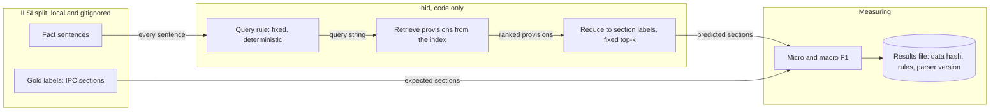

# Slice 2: Score the deterministic baseline on the public ILSI benchmark

Status: draft, waiting on the open questions below

## Problem Statement

Slice 1 proved the harness is reproducible and can fail, on 45 items I wrote and checked myself. That tells nobody how Ibid compares with anything outside this repo. There is a public Indian statute-identification benchmark (ILSI) with published scores, and I have no number for Ibid on it. Slice 1's search also cannot answer a case-facts paragraph at all: realistic sentences return no hits. Without a fixed way to turn facts into a query and a fixed way to turn retrieved provisions into a label set, any ILSI score would depend on choices nobody wrote down.

## Solution

One command loads a local copy of the ILSI split I choose, builds each query from the fact sentences by a written, deterministic rule, retrieves IPC provisions with Ibid's existing index, reduces them to section labels with a fixed cut-off, and scores micro and macro F1 against the labels. The results file records the data hash, the rules and the parser version, and two runs are byte-identical. The output is an honest number and a comparison table with the published scores and their caveats. It sets no target.

## User Stories

1. As the builder, I want the ILSI split loaded from a local path and never committed, so that the license terms are respected.
2. As the builder, I want the file's SHA-256 recorded in every results file, so that a score is tied to the exact data.
3. As the builder, I want a written query rule that turns fact sentences into a query without a model, so that retrieval stays deterministic (ADR 0001).
4. As the builder, I want retrieved sub-provisions rolled up to their IPC section, so that predictions are comparable with section labels.
5. As the builder, I want a fixed cut-off (top-k or similar) chosen on the dev split and frozen before the test split is touched, so that I cannot tune on the test data.
6. As the builder, I want micro and macro F1 computed the way the official evaluation script does, so that the number is comparable.
7. As the builder, I want per-label results, so that I can see which sections the baseline never finds.
8. As the builder, I want two consecutive runs to be byte-identical, so that the harness is proven deterministic on a larger input.
9. As the builder, I want a sample run of about 200 items to be fast, so that I can iterate on the harness without the full split.
10. As a reader, I want a table next to the score showing the published numbers, their source and what is not comparable, so that the result is not oversold.

## Implementation Decisions (proposed, not settled)

- Reuse the slice 1 index and `ibid eval` seam. The ILSI scorer is a new category of run, not a new retrieval path.
- The query rule is plain code (tokenise, drop stop words from a fixed list, join with OR). Open question 3 below covers whether ADR 0001 needs an addendum.
- Labels are the 100 IPC sections the benchmark uses. Predictions outside that set are ignored for the score and reported separately.
- The data lives under `data/raw/ilsi/`, which is already gitignored.

## Testing Decisions

- A good test checks behaviour through the run command: fixed tiny fixture of invented fact sentences and labels (not ILSI text), expected predictions and F1.
- Known-bad checks: a corrupted label file lowers the score, a changed rule is reflected in the recorded rule hash, and a changed data byte is refused.
- The official evaluation script's output is compared with ours on the same predictions, once, before any number is reported.

## Out of Scope

- Any language model, training, embeddings or reranking.
- BNS. ILSI has IPC labels only.
- Submitting to the leaderboard.
- Claiming a rank. Comparison is a table with caveats.

## Open questions (need your answers before this becomes tickets)

1. **Access.** The dataset is gated: you must accept its conditions with your own account and download it (about 1.6 GB for all tasks). Do you accept the non-commercial license for this research? I cannot accept terms for you.
2. **What claim do you want?** My recommendation: report the baseline honestly against the published numbers, and separately report the property no classifier has, that every returned citation exists in the Act text by construction. I would not set a target of beating the published macro-F1, since a keyword baseline on long fact text is unlikely to.
3. **Query rule.** Fact paragraphs need a fixed rule to become a query. That is deterministic code, not a model, but ADR 0001 says "the raw query only". Do you want an ADR 0003 stating that fixed, documented tokenisation of the raw query is allowed?
4. **Output rule.** Fixed top-k across all cases, or a score threshold? I recommend a fixed k chosen on dev only, then frozen.
5. **Which split is scored?** If test labels turn out to be hidden, dev is the only locally scorable split. I need to open the data to confirm which it is.
6. **Evaluation protocol.** The official script is on OneDrive and the paper says both "mF1" and "macro-F1". I want to read the script before deciding micro or macro as the headline. Can you fetch the OneDrive folder if my tools cannot?
