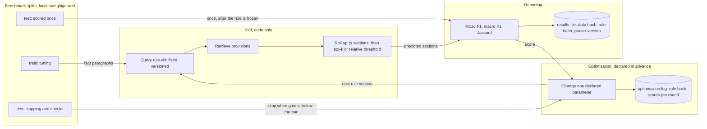

# Slice 2: Score the deterministic baseline on a public statute-identification benchmark

Status: decisions recorded 2026-10-11, one question open (data download)

## Problem Statement

Slice 1 proved the harness is reproducible and can fail, on 45 items I wrote and checked. That tells nobody how Ibid compares with anything outside this repo. There is a public Indian statute-identification task with published scores, and I have no number for Ibid on it. Slice 1's search also cannot answer a case-facts paragraph: realistic sentences return no hits ([ADR 0004](../../docs/adr/0004-fixed-tokenisation-of-the-raw-query.md)).

## Solution

One command loads a local copy of the benchmark's splits, turns each fact paragraph into a query by a written, versioned rule, retrieves IPC provisions with the existing index, reduces them to section labels, and scores micro and macro F1 plus Jaccard. The rule's parameters are tuned on the training split by a declared protocol until improvement saturates, then frozen, then the test split is scored exactly once. The report shows the round-0 baseline next to the final number and the published scores with caveats.

## Decisions (owner, 2026-10-11)

1. **Claim.** Report the number. Optimise until the gain saturates, then report the final number. Protocol below keeps the test set out of the loop.
2. **Query rule.** Allowed, as a fixed versioned tokenisation. See ADR 0004.
3. **Output rule.** Report both: a fixed top-k, and a relative score threshold (predict every section scoring at least a fraction r of the top score). The threshold is relative because BM25 scores are not comparable across queries.
4. **Data.** Manual review gates the IL-TUR copy, so use the LeSICiN Zenodo release (CC BY 4.0, open access). The owner may still request IL-TUR access in parallel.

## Optimisation protocol (proposed, for the owner to veto)

- **Splits.** Train is the tuning set, dev is the stopping and sanity check, test is scored once at the end.
- **Declared knobs only.** Tokenisation choices, the fixed stop-word list, term weighting parameters of the index's ranking function, which provision levels are indexed, the roll-up to sections, k and the threshold r. Nothing learned from labels. A label-frequency prior is out of scope unless the owner approves it, since it would be learning from the training labels.
- **One change per round**, each recorded with its rule version, parameters and scores in `results/optimisation-log.json`.
- **Saturation.** Stop when dev macro-F1 gains less than 0.5 points absolute for 3 consecutive rounds, or after 20 rounds, whichever comes first.
- **Overfit check.** Report the train and dev gap. If dev stops improving while train keeps rising, stop and say so.
- **Test.** Scored once, after the rule is frozen. If it is scored a second time for any reason, the first score is reported too.
- **Comparison.** Published numbers appear in a table with their source and the caveat that the dataset copy, split counts and metric protocol may differ.

## User Stories

1. As the builder, I want the benchmark splits loaded from a local path and never committed.
2. As the builder, I want each data file's SHA-256 recorded in every results file.
3. As the builder, I want a written, versioned query rule with no model (ADR 0004).
4. As the builder, I want retrieved sub-provisions rolled up to their IPC section so predictions match section labels.
5. As the builder, I want both a fixed top-k and a relative threshold reported.
6. As the builder, I want micro F1, macro F1 and Jaccard.
7. As the builder, I want per-label results, to see which sections the baseline never finds.
8. As the builder, I want the optimisation loop to log every round, so the path to the final number can be audited.
9. As the builder, I want the test split scored once, after freezing.
10. As the builder, I want two runs with the same rule and data to be byte-identical.
11. As the builder, I want a 200-item sample mode for fast iteration.
12. As a reader, I want a table next to the score with published numbers and what is not comparable.

## Testing Decisions

- Behaviour through the run command, on a tiny invented fixture (not benchmark text).
- Known-bad checks: a corrupted label file lowers the score, a changed rule changes the recorded hash, a changed data byte is refused, and scoring the test split twice is refused without an explicit flag.
- Where possible, compare our F1 to the benchmark's own evaluation script on the same predictions, once, before reporting.

## Out of Scope

- Any language model, training, embeddings or reranking in this slice.
- BNS: the labels are IPC only.
- Submitting to a leaderboard.
- Claiming a rank.

## Open

- **Download.** The Zenodo files needed are `train.jsonl` (319,771,764 bytes), `dev.jsonl` (85,261,365), `test.jsonl` (106,092,603), `secs.jsonl` (46,219) and `label_vocab.json` (4,795), about 511 MB, from https://zenodo.org/records/6053791. The 2.25 GB sent2vec file and the model checkpoint are not needed. Waiting on the owner's yes.
- **Whether test labels are present.** Neither the record nor the README says. Known after opening `test.jsonl`.
- **Comparability.** The record does not mention IL-TUR. Split counts differ slightly between papers, so numbers may not be directly comparable until checked.
