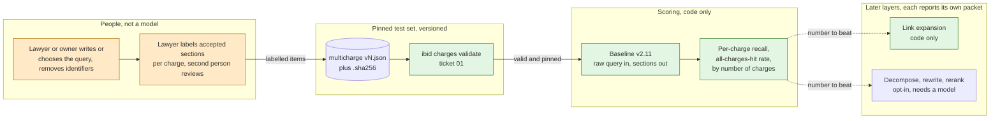

# Slice 3: A real multi-charge test set and a per-charge score for the baseline

Status: draft, 2026-10-12. Decisions needed from the owner are listed under "Decisions needed". Ticket 01 is written. The rest are proposed titles.

## Problem Statement

Slice 2 scored the baseline on a public benchmark: micro-F1 9.6 and macro-F1 6.2 on the ILSI test split. That number says little about the case the owner cares about, a query that describes several offences at once, written the way a person with a real case writes it. The benchmark cases are judgments, scored per section across 100 labels, and the queries a language model writes for tests are sanitised and mild. No number exists for how often Ibid finds each charge in a realistic multi-charge query, and without that number no later layer (link expansion, a model that decomposes the query) can be shown to beat the baseline, which ADR 0001 requires of any opt-in layer.

## Solution

A small, hand-collected set of 50 to 100 multi-charge queries, each written or chosen by a person and labelled with the sections a lawyer accepts for each charge. One command scores any rule on it by charge: the share of charges found, and the share of queries in which every charge is found. The baseline (rule v2.11) is scored first. The set is pinned, kept out of every tuning loop, and scored once per rule version.

Orange boxes need people. Green boxes are code an agent can build and test.

## Decisions needed

1. Who collects the queries and labels. The set is only as good as its authors. Options: a lawyer the owner knows, the owner with a lawyer reviewing, or excerpts chosen from public judgments with a lawyer labelling. The ticket format accepts all three and refuses anything written by a model.
2. Where the real set lives. Real fact patterns can be sensitive even when anonymised. Options: gitignored under a private path with only its hash committed, or committed to this private repository. The validator works on both.
3. How many items for the first version. 50 is enough to see a gap of ten points between rules and too few for small differences. A first version of 30 that is scored and reported honestly may be more useful than waiting for 100.
4. Which Act. The ILSI labels are IPC only. A BNS version of each item is possible through the concordance, but only for the 12 verified entries today. Proposal: IPC first, BNS later.

## User Stories

1. As the owner, I want the multi-charge set in a versioned, hash-pinned file, so every score traces to exact data.
2. As the owner, I want each query written or chosen by a person, with its author type recorded, so assistant-written sanitised queries cannot enter.
3. As the owner, I want each charge labelled with the sections a lawyer accepts for it, where one charge may accept several sections.
4. As the builder, I want per-charge recall and the all-charges-hit rate for any rule on the set.
5. As the builder, I want the baseline v2.11 scored on the set first, so every later layer has a number to beat.
6. As the builder, I want a layer's output scored by the same command and reported separately from the baseline, as ADR 0001 requires.
7. As a reader, I want results split by number of charges (1, 2, 3 or more), so simple queries stay visible.
8. As the owner, I want the set kept out of any tuning loop: tuning stays on the ILSI train and dev splits, and the set is scored once per rule version.

## Proposed tickets

Only ticket 01 is written. The rest are titles, to be written when the owner has answered the decisions above.

| # | Title | Kind | Blocked by |
|---|---|---|---|
| 01 | Define the multi-charge set file and refuse any file that breaks its rules | code | none |
| 02 | Score a rule by charge: per-charge recall, all-charges-hit rate, strata by charge count | code | 01 |
| 03 | Collect the first version: template, instructions for the author, anonymisation checklist, then the items | people | 01 |
| 04 | Score the baseline v2.11 on the first version and publish the number | run | 02, 03 |
| 05 | Code-only link expansion after ranking, along definition and punishment edges | code | 04 |
| 06 | Untried baseline knobs (stemming, indexed levels, roll-up, stop words) under the slice 2 protocol | code | 04 |

A model layer (decompose, rewrite, rerank) is not in this slice. It needs the number from ticket 04, a model choice and a cost estimate, and it would be an opt-in layer under ADR 0001.

## Testing Decisions

- Behaviour through the validate and score commands on small invented fixtures. Fixture queries are mild by design, and no quality number is taken from them.
- Known-bad checks: a query marked `model` is refused, a changed byte is refused by the pin, a section absent from the index is refused, and a score that counts only the first accepted section is shown to differ from one that counts any.
- The set is never read by an optimisation round. Any scoring of it is recorded with the rule version and the data hash, and a second scoring of the same rule version is reported beside the first.
- Per-label results from the ILSI test split were read after scoring and must not steer tuning. Tuning evidence in this slice comes from ILSI train and dev, and from the multi-charge set only through one scoring per rule version.

## Out of Scope

- Any model call in retrieval, in this slice.
- Retraining or fine-tuning anything.
- A BNS version of the set.
- Generating queries with a language model, even for fixtures that feed a score.
- A new public benchmark. The set is for Ibid's own measurement.

## Still open

- The metric for "found". Proposed: a charge is found when any accepted section is in the top k or above the threshold. Per-charge precision (noise per query) is reported separately and not folded in.
- Whether k and r for the baseline are the frozen v2.11 values or are re-chosen on this set. Proposal: frozen values, since re-choosing on the set would tune to it.
- Ticket 04 gives one number for the baseline. Whether that number is enough to justify a model layer is a decision for after it exists.
- Candidate ideas in [the literature note](../../docs/research/legal-retrieval-literature.md) that cost a model call are deferred. Their published numbers are not checked.
