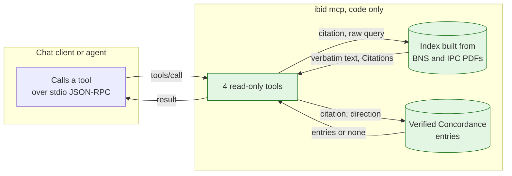

# Slice 4: An MCP server over the deterministic lookups

Status: draft 2026-10-14, awaiting owner "approved".

## Problem Statement

Ibid answers only through `ibid eval` and its siblings, which are built for scoring, not for asking. A chat client or an agent that wants the verbatim text of a Provision, a keyword hit list, a Cross-reference chain or a Concordance entry has no way to call Ibid. ADR 0002 already names an MCP server as the route a front end would take.

## Solution

`ibid mcp` starts a stdio MCP server. It builds the index from the source PDFs on start into a temp file (as `ibid eval` does, minus its stdout progress lines), loads one Concordance file, and exposes four read-only tools. Every tool is a thin call into the existing `index.lookup`, `index.search`, `index.unresolved` and `concordance.lookup`. No model, no query rewrite, no embedding (ADR 0001).

## Decisions

1. Index: built from `IBID_BNS_PDF` / `IBID_IPC_PDF` (flags `--bns`, `--ipc`, same defaults as `ibid eval`) on start.
2. Concordance: `--concordance`, default `concordance/v3.json` (the newest pinned file, the one slice 3 scored with; the owner's handoff text said v2, so this is a flagged assumption).
3. Four tools: `get_provision`, `search`, `cross_references`, `concordance`. No write or eval tools.
4. Entry point: a new `mcp` subparser in `src/ibid/cli.py`, code in `src/ibid/mcp.py`. Standard library only (ADR 0002): newline-delimited JSON-RPC 2.0 on stdin/stdout, methods `initialize`, `notifications/initialized`, `tools/list`, `tools/call`, `ping`.

## User stories

1. As a client, I connect and get a valid `initialize` result with the server's tool capability, then `tools/list` returns exactly the four tools, each with a JSON schema.
2. As a client, `get_provision` with an exact Citation (for example `BNS 103`) returns the verbatim text and the child Citations, byte for byte what `index.lookup` returns.
3. As a client, `get_provision` with a Citation that is not in the index returns a tool error that says so, and never a near match.
4. As a client, `search` with a raw query returns up to `limit` (default 10) ranked Provisions as Citation plus text, in the same order as `index.search`, and the query is passed through unchanged.
5. As a client, `search` with a query that is not valid FTS5 syntax returns an empty list, not an error and not a rewritten query.
6. As a client, `cross_references` with a Citation returns the resolved Cross-reference chain in the stored order, and lists unresolved references for that Provision with their reason.
7. As a client, `concordance` with a Citation and a direction (`ipc_to_bns` or `bns_to_ipc`) returns the verified entries, or the string `no verified concordance`. Unverified entries are never returned.
8. As a client, an unknown tool name, a missing argument or a malformed JSON-RPC line gets a JSON-RPC error and the server keeps running.
9. As an operator, `uv run ibid mcp` exits non-zero with a clear message on stderr when a PDF or the Concordance file is missing. Nothing but protocol messages is ever written to stdout.

## Test seam

One seam: the server's tool calls. A `unittest` harness starts `ibid mcp` as a subprocess, writes JSON-RPC lines to its stdin, reads stdout, and asserts on the `tools/call` results. Expected values come from the existing `index` and `concordance` functions run on the same index in the test, so a divergence between the server and the library fails. Each test is run once against a known-bad server (a stub that rewrites the query, or returns a near-match citation) to see it fail.

## Out of scope

- Any chat UI or client (LibreChat stays deferred).
- Any change to the frozen rule, a gold set, or a pinned concordance file (`gold/*`, `concordance/*`).
- Any model, query rewrite, embedding or the opt-in association layer (`assoc.py`) in the tool path.
- Network transports (HTTP, SSE), authentication, resources, prompts, sampling.
- A prebuilt-index flag or a new index build command.
- Write tools, eval tools, `list_unresolved` as a separate tool.
- A new dependency, or the official MCP Python SDK.
- Any claim of lawyer review. Scores stay private.
