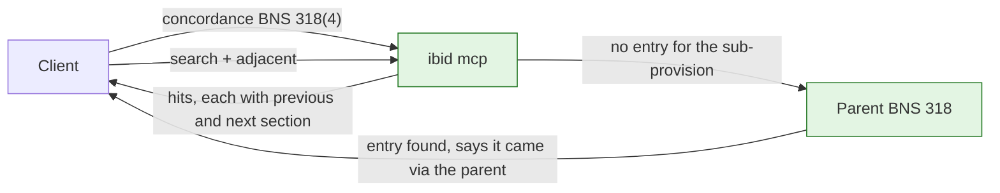

# Slice 5: Close the three gaps a real MCP client hit

Status: approved 2026-10-15 ("go" after the gap list).

## Problem Statement

A real client session on the slice 4 server (2026-10-15) exposed three gaps, each reproduced by tool calls:

1. `concordance BNS 318(4)` returns `no verified concordance`, while `BNS 318` maps to IPC 420. Concordance entries are section level, and a client that holds a sub-provision Citation gets nothing.
2. `search "criminal breach of trust"` returns IPC 406, 407 and 408 but not IPC 405, the section that defines the offence. The client had to fill the gap from its own memory.
3. `concordance` requires a `direction` argument. The client's first question used three failed tool calls, most likely including this one.

## Solution

Three small changes to `src/ibid/mcp.py` and the code it calls. No change to ranking, so the frozen rule and its scores are untouched (ADR 0001). No model.

## Decisions

1. Fallback: a Citation with a sub-provision suffix, such as `BNS 318(4)`, that has no verified entry falls back to its section (`BNS 318`). The result names the Citation it came through. No fallback for a Citation that is already a section.
2. `direction` becomes optional, inferred from the Citation prefix (`IPC` means `ipc_to_bns`, `BNS` means `bns_to_ipc`). An explicit direction that contradicts the prefix is an error, never silently corrected.
3. `search` gains an optional boolean `adjacent` (default false). When true, each hit also lists the Citation and heading line of the previous and next section of the same Act in document order. Ranking and the hit list are identical with or without it.

## User stories

1. As a client, `concordance` for `BNS 318(4)` returns the verified entries of `BNS 318` and a field saying they came through `BNS 318`.
2. As a client, `concordance` for a sub-provision whose section also has no verified entry returns `no verified concordance`, not an error.
3. As a client, `concordance` for a section Citation behaves exactly as before, with no fallback field.
4. As a client, `concordance` with only a Citation infers the direction from its prefix and returns what the explicit direction would.
5. As a client, `concordance` with a direction that contradicts the prefix gets a tool error naming the conflict.
6. As a client, `search` with `adjacent: true` returns the same hits in the same order as without it, each carrying `previous` and `next` Citations with their heading line; the first and last section of an Act have a null on the missing side.
7. As a client, a search for "criminal breach of trust" with `adjacent: true` makes IPC 405 visible next to IPC 406.
8. As a client, `tools/list` shows the updated schemas: `direction` not required, `adjacent` a boolean.
9. As a maintainer, every slice 4 server test still passes unchanged.

## Test seam

The server's tool calls, as in slice 4: a `unittest` harness drives `ibid mcp` over stdio. Expected values come from the existing `index` and `concordance` functions on the same index. Each new test is run once against a known-bad server (fallback applied to a section, direction silently corrected, `adjacent` that reorders hits) to see it fail.

## Out of scope

- Any change to the frozen rule, ranking, a gold set or a pinned concordance file.
- Boosting definitions inside ranking, any model, embedding or the association layer.
- New tools, and sub-provision-level concordance entries.
