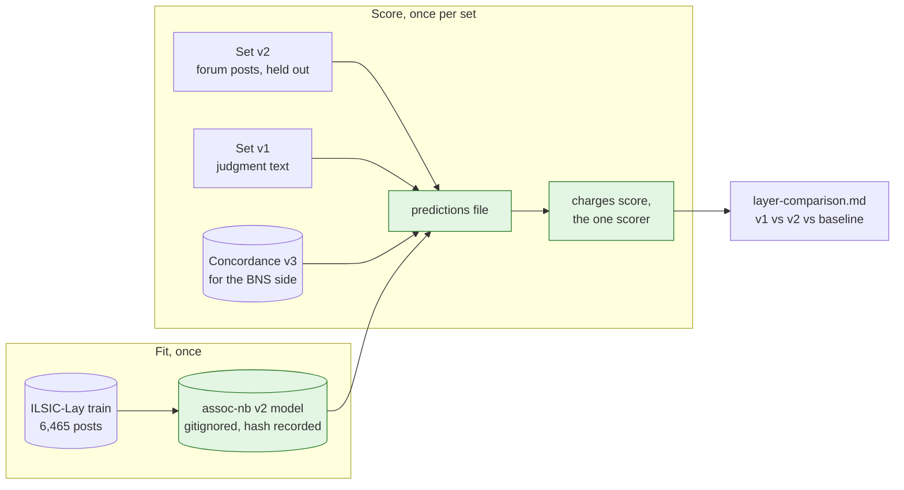

# Slice 6: Fit the association layer on layperson text

Status: approved 2026-10-16 (owner: "go", then "approved" for the download).

## Problem Statement

The learned association layer (ADR 0005, layer `assoc-nb v1`) is fitted on court-judgment fact text with 98 usable ILSI labels. On the layperson forum posts of set v2 it finds 39.3% of IPC charges. Two causes are visible in the data, not guessed:

1. Only 19 of the 30 IPC sections cited in set v2 are in its vocabulary, so it cannot name the other 11.
2. Its training text is judgments, and the test text is a layperson story.

The ILSIC layperson train split (6,465 posts, downloaded 2026-10-16, `data/raw/ilsic/FT-Layman-train.jsonl.xz`) covers 118 IPC sections (98 with at least 5 posts), and all 30 of set v2's sections. The widening is modest: 118, not the 575 sections of the Act.

## Solution

A new layer version, `assoc-nb v2`: the same method as v1 (term counts per section, naive-Bayes style ranking, k=5, fixed tokenisation, no model call), fitted on the layperson train split instead of ILSI. Opt-in under ADR 0005, never in the baseline. It is scored once per set through the existing uniform scorer, and compared with v1 and the baseline.

## Decisions

1. Training data: the ILSIC-Lay train split only. Nothing from ILSI, the Layman test split, or the dev split. (Default; the owner has not been asked whether to add ILSI text.)
2. Vocabulary: IPC sections that occur in at least 5 train posts (98 sections). (Default; the owner has not chosen the threshold.)
3. Labels come from the `answer` field, offence sections of the IPC only, IPC 34, 149 and 120B excluded, as in set v2. Other Acts are counted and dropped.
4. Tokenisation, smoothing and k are those of v1 and are not changed (ADR 0004, ADR 0005).
5. The model file is `data/assoc-nb-v2.json`, gitignored; its SHA-256 goes into every predictions file.
6. A new ADR 0006 widens ADR 0005's "from which data" clause to the ILSIC-Lay train split, records the non-commercial licence, and keeps everything else in ADR 0005.

## User stories

1. As the owner, `ibid assoc fit` accepts the ILSIC-Lay train file and writes `assoc-nb v2` with a header giving the train file hash, the section threshold, the post count and the number of posts dropped (no offence section, or none above the threshold).
2. As the owner, no post of the Layman test split, and none of the 30 set v2 ids, is in the training data, and a test asserts it.
3. As the owner, `ibid assoc predict` with the v2 model writes a predictions file for set v2 and for set v1, naming the layer `assoc-nb` version `v2`.
4. As the owner, `ibid charges score --predictions` scores each of those once, and the scorer refuses a second scoring of the same layer version on the same set (the ledger).
5. As the owner, `results/layer-comparison.md` shows `assoc-nb v1`, `assoc-nb v2` and the baseline side by side per set and Act, with the label-incompleteness caveat for set v2 and the in-distribution caveat for v2 on set v2.
6. As the owner, a short report says how many of set v2's sections the v2 vocabulary covers (expected 27 of 30 at the threshold), and how recall changes on the sections that v1 could not name against those it could.
7. As the owner, the layer imports only the standard library and `ibid`, and a test fails if it does not (as for v1).
8. As the owner, ADR 0006 exists and the baseline path, the frozen rule and its scores are byte-identical before and after the slice.

## Test seam

One seam, as in slices 3 to 5: the `ibid` commands (`assoc fit`, `assoc predict`, `charges score`, `charges compare`) driven by `unittest`. Fixtures are invented posts and labels in the same shape as ILSIC-Lay. Each new test is run once against known-bad input to see it fail: a fit that includes a held-out id, a predictions file whose layer version is wrong, a second scoring of the same version.

## Out of scope

- The Layman test split as a benchmark of its own, the dev split, the court dataset, and any section outside the 118.
- Any change to the baseline, the frozen rule, tokenisation, a gold set, or a pinned concordance file.
- Wiring the layer into the MCP server (a later slice, only if v2 beats v1 and the baseline).
- Any claim of legal accuracy: the forum labels are incomplete and no lawyer reviewed them.
