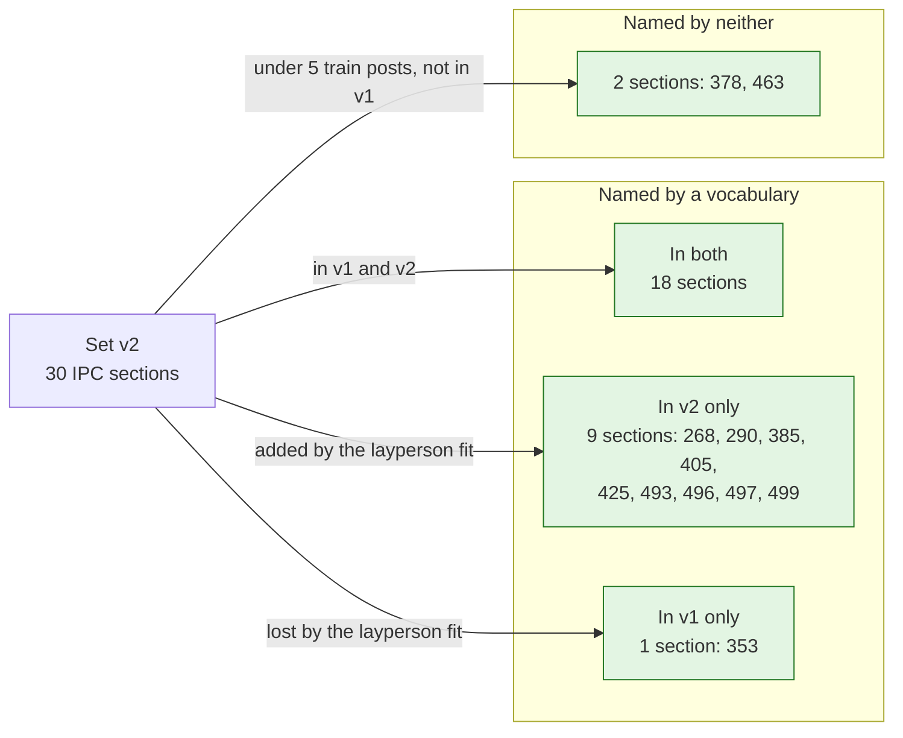

# Slice 6 report: vocabulary coverage and recall on set v2

Recompute every number here (from the repo root, data dir holds the two fitted models, `assoc-nb-v2.json` refitted with the ticket 6 command and matching its recorded SHA-256):

```bash
uv run python .scratch/slice-6/v2-report.py data
```

The script stops if a model hash differs from the one in the predictions file, or if its own recall differs from the scored results file.

## Vocabulary coverage of set v2's 30 IPC sections

v2 names 27 of 30 (96 sections at the 5-post threshold). v1 names 19 of 30 (100 sections).



The set splits into the three requested groups (both 18, v2 only 9, neither 2) plus one section, 353, that only v1 names. The 18 + 9 + 1 + 2 = 30.

## IPC recall on set v2, by whether v1's vocabulary names the charge's section

Charges found / charges counted, top 5, rolled up to the section. 67 + 17 = 84.

| charges whose section is | v1 | v2 |
| --- | --- | --- |
| in v1's vocabulary (19 sections) | 33 of 67 (49.3%) | 46 of 67 (68.7%) |
| not in v1's vocabulary (11 sections) | 0 of 17 (0.0%) | 0 of 17 (0.0%) |
| all | 33 of 84 (39.3%) | 46 of 84 (54.8%) |

## BNS recall on set v2, grouped by the charge's IPC section

Only charges with a Concordance counterpart are counted. 65 + 16 = 81.

| charges whose IPC section is | v1 | v2 |
| --- | --- | --- |
| in v1's vocabulary | 35 of 65 (53.8%) | 48 of 65 (73.8%) |
| not in v1's vocabulary | 4 of 16 (25.0%) | 4 of 16 (25.0%) |
| all | 39 of 81 (48.1%) | 52 of 81 (64.2%) |

The 4 BNS hits outside v1's vocabulary come from BNS sections that also stand for an IPC section the layer does name, so they are not evidence of new coverage.

## What this says

The wider vocabulary did not produce a single new IPC charge found. All 17 charges on sections v1 could not name are still missed by v2, though v2 puts one of the nine newly named sections in its top 5 for 4 of 30 posts (v1 does so for 0). The whole gain of v2 on set v2 (39.3% to 54.8% IPC) is on sections v1 could already name, where it rises from 49.3% to 68.7%.

## Does v2 beat v1 and the baseline

Recall %, from the scored results files (baseline is top-k / threshold).

| set | Act | baseline | assoc-nb v1 | assoc-nb v2 |
| --- | --- | --- | --- | --- |
| v2 | IPC | 4.8 / 6.0 | 39.3 | 54.8 |
| v2 | BNS | 9.9 / 6.2 | 48.1 | 64.2 |
| v1 | IPC | 3.1 / 5.1 | 41.8 | 15.3 |
| v1 | BNS | 4.1 / 5.1 | 37.8 | 16.3 |

On set v2, v2 beats v1 and the baseline for both Acts. On set v1 (judgment text), v2 beats the baseline but loses to v1 for both Acts, as expected of a layer fitted on layperson text. v2 does not beat v1 on both sets, so MCP wiring is a later slice only if the owner accepts that trade; it is not queued here.

## Caveats

Set v2's labels are incomplete (extracted from forum lawyers' replies, which cite fewer sections than apply), so recall is meaningful and precision is not. v2 was fitted on posts from the same corpus and forum as set v2, with the test posts held out, so the set v2 scores are in-distribution. Nothing here is a claim of legal accuracy: no lawyer reviewed the labels or the predictions.
