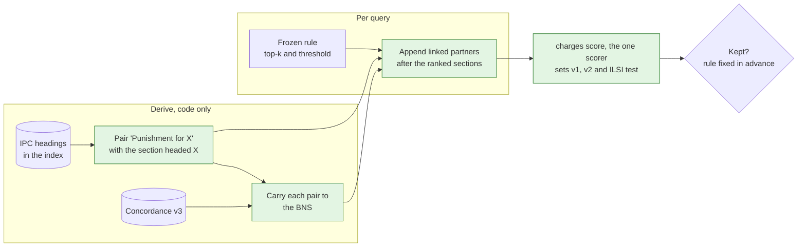

# Slice 7: Definition and punishment links, derived from headings, expanded after ranking

Status: approved 2026-10-17 (owner: "lets start on slice 7 now", after the reframing below).

## Problem Statement

Two failures repeat. A murder query matches the definition (IPC 300) and the punishment lives in IPC 302, which the frozen rule finds in 4 of 3,246 ILSI test cases. A search for "criminal breach of trust" returns IPC 406 to 408 and not the defining IPC 405. The literature note (candidate 2) proposed fixing both with code-only link expansion after ranking, along "definition and punishment edges of the cross-reference graph".

**That premise fails on the data.** The cross-reference graph has 615 edges (586 resolved) and none of these pairs: IPC 302, 406 and 420 have no edge to IPC 300, 405 and 415. The links are implicit ("commits murder" names a defined term, not a section number). So expansion over the existing graph would do nothing for the cases that motivated it. A different, still deterministic source of the links is needed.

**What the data does support.** 43 IPC sections are headed "Punishment for X". For 23 of them another section is headed exactly X (302 and 300, 376 and 375, 379 and 378, 323 and 321, 363 and 359, 392 and 390, among them). The BNS has no headings for 251 of its 358 sections, so BNS links must come through Concordance v3.

## Solution

A small module derives definition-punishment links from IPC headings and carries them to the BNS through verified Concordance entries. A new layer, `links v1`, takes the frozen rule's ranked output and appends the linked partners of each predicted section after the original predictions. The ranking, the frozen rule and its scores are untouched (ADR 0001). No model.

## Decisions

1. Link rule (IPC): a section headed "Punishment for X" is linked, in both directions, to every other top-level section whose heading equals X after lowercasing and stripping the trailing full stop. Nothing else creates a link. No fuzzy match, no stemming.
2. Link rule (BNS): if IPC sections A and B are linked, and Concordance v3 serves a mapping from A to BNS a and from B to BNS b with a different from b, then a and b are linked. Only verified entries are used.
3. Expansion: for each predicted section, in rank order, append its linked partners that are not already predicted. Original predictions keep their order and come first. An expansion never changes which sections the frozen rule predicts.
4. Where it applies: both outputs of the frozen rule (top-k with k=5, threshold with r=0.7), on IPC and BNS.
5. Decision rule, fixed before any score: `links v1` is kept as an opt-in output only if per-charge recall rises on both multi-charge sets (v1 and v2) and ILSI test micro-F1 does not fall. Otherwise the result is recorded as negative, nothing is wired into the MCP server, and the links module stays as a documented dead end. The rule has no parameters, so nothing is tuned.
6. ADR 0007 records the heading-link rule and why the cross-reference graph was not used.

## User stories

1. As the owner, a test shows the resolved cross-reference graph has no edge between IPC 302 and IPC 300, 406 and 405, or 420 and 415, so the finding above is reproducible from the repo.
2. As the owner, `ibid links list` prints every derived IPC link and every carried BNS link as pairs of Citations, deterministic and byte-identical on two runs, with the counts (expected 23 IPC pairs; the BNS count is whatever Concordance v3 supports).
3. As the owner, the IPC links include 302 and 300, 376 and 375, and 379 and 378, and exclude a section whose heading merely contains X.
4. As the owner, a BNS link is created only through verified Concordance entries; an unverified entry creates none.
5. As the owner, `ibid links expand` reads a predictions file from `ibid charges export-baseline` and writes a predictions file for layer `links` version `v1`, with the originals first and in order, the partners after, and the baseline file's hash in its inputs.
6. As the owner, `ibid charges score --predictions` scores that file once per set and Act, and refuses a second scoring of `links v1` on the same set.
7. As the owner, `results/layer-comparison.md` shows the baseline and `links v1` side by side on sets v1 and v2 and on ILSI test, with the mean predictions per item, so the cost in extra predictions is visible next to the recall.
8. As the owner, a short report states the decision-rule outcome (kept or negative), how many charges were newly found by expansion, how many predictions were added, and what share of those added predictions were correct.
9. As the owner, the baseline path, the frozen rule, every pinned file and all existing results are byte-identical before and after the slice.

## Test seam

The `ibid` commands: `links list`, `links expand`, `charges score`, `charges compare`, driven by `unittest`. Fixtures are an invented mini-Act whose headings follow the real pattern, plus a small invented concordance. Each new test is run once against known-bad input to see it fail: a fuzzy heading match, a link through an unverified entry, an expansion that reorders the originals, a second scoring of the same layer version.

## Out of scope

- Any change to ranking, the frozen rule, tokenisation, a gold set, or a pinned concordance file.
- Expansion before ranking, any model, embedding or the association layers.
- Wiring links into the MCP server (a later slice, only if the decision rule says kept).
- Sections without a "Punishment for" heading, such as "Attempt to murder" (IPC 307), and sub-provision links.
