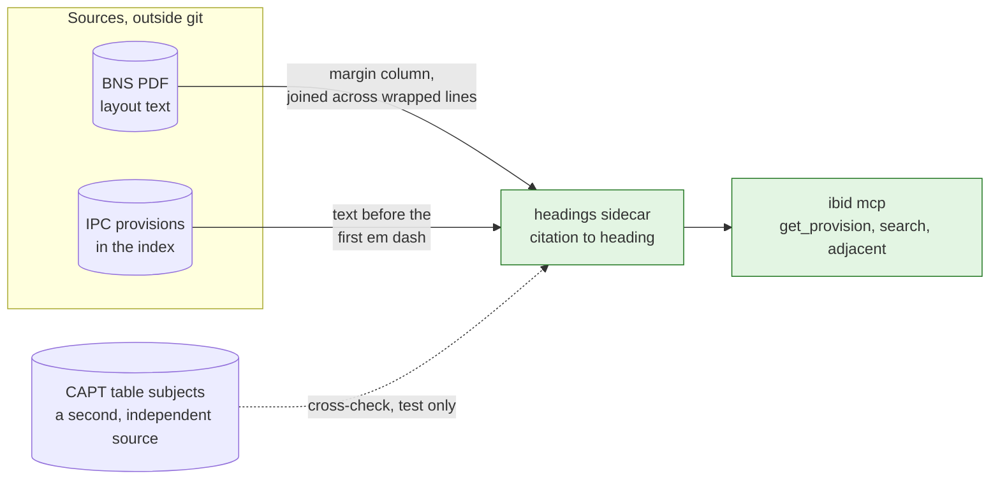

# Slice 8: Real section headings for the BNS

Status: approved 2026-10-18 (owner: "the three slices you suggested are fine, move ahead").

## Problem Statement

The BNS gazette prints each section's heading in a right-hand margin column ("Marriage ceremony fraudulently gone through without lawful marriage." beside section 83). Ibid's BNS parser reads the body text only, so 251 of 358 BNS sections have no heading. The MCP `search` with `adjacent` therefore shows a truncated opening sentence where a title belongs (decision D-001 chose that as a fallback), and `get_provision` returns text with no title at all.

## Solution

A new module reads the margin headings from the BNS PDF's layout text and pairs each with its section. It is a sidecar, not part of the index: the `provision` table, the full-text index, `PARSER_VERSION`, every pinned file and every committed result stay byte-identical (the index file's hash is recorded in results, so a schema change would make every result disagree with it). The MCP server loads the sidecar at start and adds a `heading` field. IPC headings already exist as the text before the first em dash, and are surfaced the same way.

## Decisions

1. Source for BNS headings: `pdftotext -layout` of the BNS PDF. A heading is the text of the right-hand margin column between one section's first line and the next section's first line, wrapped lines joined with single spaces.
2. Headings are never written into the index, the `provision` text, or any pinned file. Verbatim text is unchanged.
3. Only top-level sections have headings. Sub-provisions return no heading. Chapter and group titles are not headings.
4. Where no heading can be read for a section, the field is null and the D-001 fallback (first line of the text, cut at the first em dash or 100 characters) still applies in `adjacent` only.
5. `ibid headings list --act bns|ipc` prints one line per section, `citation<TAB>heading`, with a count of sections with and without a heading.

## User stories

1. As the owner, `ibid headings list --act bns` gives a heading for at least 350 of the 358 BNS sections, and lists every section without one.
2. As the owner, BNS 83, 85, 86 and 87 have the headings the PDF prints: "Marriage ceremony fraudulently gone through without lawful marriage.", "Husband or relative of husband of a woman subjecting her to cruelty.", "Cruelty defined." and "Kidnapping, abducting or inducing woman to compel her marriage, etc." (the last as printed, wrapped lines joined).
3. As the owner, a test compares BNS headings with the subject column of the CAPT correspondence table (a different source) after lowercasing and removing punctuation, and at least 90 percent of the sections the table lists match exactly. Mismatches are listed. The test is skipped with a clear message when the CAPT text file is absent.
4. As a client, `get_provision` returns `heading` for a section Citation (BNS and IPC) and null for a sub-provision.
5. As a client, each `search` hit carries `heading`, and ranking and the hit list are identical to before.
6. As a client, `adjacent` neighbours use the real heading where one exists and the D-001 fallback only where it does not.
7. As the owner, `ibid eval` still reproduces `results/baseline-v2.json` byte for byte, the index file is unchanged, and every pinned file's hash is unchanged.

## Test seam

The `ibid` commands and the MCP server's tool calls: `ibid headings list`, and the stdio harness from slices 4 and 5. Fixtures for the layout parser are invented pages with a margin column of the same shape as the real PDF (wrapped headings, a section whose body wraps past its heading, a chapter title between sections). Each new test is run once against known-bad input to see it fail: a heading read from the wrong section, a wrapped heading cut after its first line, a chapter title taken as a heading.

## Out of scope

- Any change to the index, the frozen rule, ranking, a gold set or a pinned concordance file.
- Headings for sub-provisions, chapter titles, and Hindi text.
- Using headings in retrieval (they are display only in this slice).
