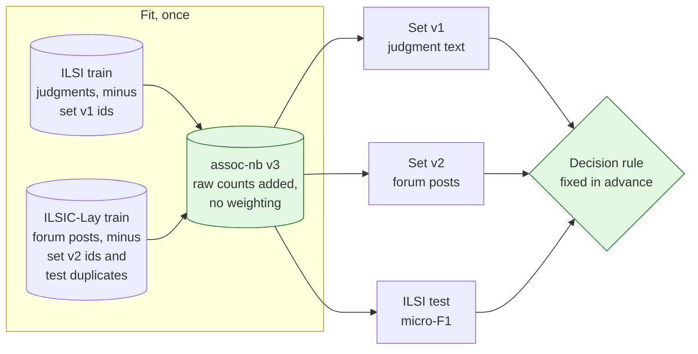

# Slice 9: One association layer fitted on both kinds of text

Status: approved 2026-10-18 (owner answered Q-002 with option 2: add court-judgment text to the training data).

## Problem Statement

The two association layers each suit one kind of text and fail on the other:

| Layer | Fitted on | Set v2 (forum posts), IPC recall | Set v1 (judgment text), IPC recall |
|---|---|---|---|
| `assoc-nb v1` | ILSI judgments | 39.3% | 41.8% |
| `assoc-nb v2` | ILSIC-Lay forum posts | 54.8% | 15.3% |

A client asking in a layperson's words and a client pasting a judgment excerpt both need an answer. The owner chose to add judgment text to the layer's training data (Q-002, option 2). This slice builds that layer, `assoc-nb v3`, and measures whether one fit can serve both.

## Solution

`assoc-nb v3` uses the same method as v1 and v2 (term counts per section, naive-Bayes ranking, k=5, fixed tokenisation, no model call). It is fitted once on the union of the two training sources, by concatenating their raw counts, with no weighting. It stays opt-in (ADR 0005). It is scored once per set and Act, and compared with v1, v2 and the baseline.

## Decisions

1. Training data: the ILSI train split minus the 30 ids of set v1, plus the ILSIC-Lay train split minus the 30 ids of set v2 and the posts that duplicate a Layman test post (the slice 6 rules, unchanged). Nothing from any test or dev split.
2. Vocabulary: IPC sections that occur in at least 5 training examples in the union. Offence sections only, IPC 34, 149 and 120B excluded, as before.
3. No weighting, no resampling, no tuning. The judgment text is 87 percent of the examples and the layer may lean towards it; that is a result to report, not something to correct in this slice. One fit, scored once per set and Act.
4. Tokenisation, smoothing and k are those of v1 and v2 (ADR 0004, ADR 0005).
5. Model file `data/assoc-nb-v3.json`, gitignored, hash in every predictions file.
6. ADR 0008 widens the data clause of ADR 0005 and ADR 0006 to the union and states the decision rule below.
7. Decision rule, fixed before any score, compared per set and Act (owner decision D-002), recall in percent:
   - Set v1, IPC and BNS: v3 recall is higher than v2's (15.3 IPC, 16.3 BNS).
   - Set v2, IPC and BNS: v3 recall is at most 5 points below v2's (54.8 IPC, 64.2 BNS), or higher.
   - ILSI test micro-F1: v3 is at least 33.4 (v1's 35.4 minus 2).
   v3 is kept as an opt-in layer only if all six comparisons hold. Otherwise the result is recorded as negative and v1 and v2 remain the two options.

## User stories

1. As the owner, `ibid assoc fit` accepts both training files and writes `assoc-nb v3` with a header giving each source's file hash, the count of examples used and dropped from each, the section threshold, and the number of sections in the vocabulary.
2. As the owner, a test asserts that no set v1 id, no set v2 id, no Layman test post and no ILSI test or dev case is in the training data.
3. As the owner, `ibid assoc predict` writes predictions files for sets v1 and v2 naming layer `assoc-nb` version `v3`, and `ibid charges score --predictions` scores each once per Act and refuses a second scoring.
4. As the owner, `ibid assoc eval` scores v3 once on the ILSI test split.
5. As the owner, `results/layer-comparison.md` shows baseline, `assoc-nb v1`, `v2` and `v3` side by side per set and Act, with the label-incompleteness caveat for set v2.
6. As the owner, a short report applies the decision rule, prints each of the six comparisons with its numbers, states kept or negative, and reports the vocabulary size and the share of training examples from each source.
7. As the owner, the baseline, the frozen rule, every pinned file and all existing results are byte-identical before and after.

## Test seam

The `ibid` commands (`assoc fit`, `assoc predict`, `assoc eval`, `charges score`, `charges compare`), driven by `unittest` with invented posts and judgments in the shape of the real files. Each new test is run once against known-bad input: a fit that includes a held-out id, a predictions file with the wrong layer version, a second scoring of the same version.

## Out of scope

- Weighting, resampling or any tuning of the mix; wiring the layer into the MCP server (slice 11 decides that); any change to the baseline or a pinned file; the dev splits.
- Any claim of legal accuracy: the forum labels are incomplete and no lawyer reviewed any label.
