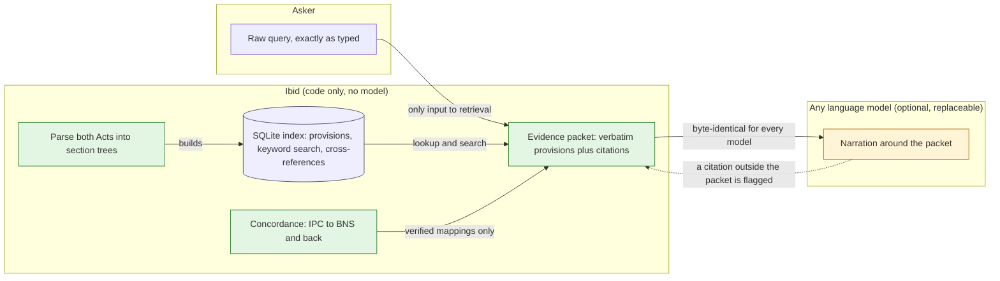

# Ibid

[](../../actions/workflows/ci.yml)


A local, deterministic retrieval engine for Indian criminal statute (the IPC and the BNS) that returns **verbatim text and exact citations**. The language model is replaceable. The evidence is not.

Ask for `BNS 103(1)` and you get that provision's text, byte for byte, the provisions it refers to, and the IPC provision it replaced. Ask the same question twice, or through a different model, and the evidence is identical.

## How it works



Retrieval depends only on the raw query ([ADR 0001](docs/adr/0001-retrieval-independent-of-the-model.md)). No model rewrites the query, picks sections or expands references.

## Status

| Slice | What it delivers | State |
|---|---|---|
| 1 | Parse both Acts, resolve cross-references, score a frozen gold set, byte-identical results | Done |
| 2 | Public statute-identification benchmark (ILSI) | Planned, see `.scratch/slice-2/` |

What slice 1 measured on 2026-10-11:

| Measure | Value |
|---|---|
| BNS sections recovered | 358 of 358 |
| IPC sections recovered | 575 of 575 |
| Gold set | 45 items (version 2), pinned by SHA-256. Version 1 is kept for history |
| Concordance | 66 entries. 12 are served as verified (8 human-checked, 4 agent-checked at the owner's request). The other 54 answer "no verified concordance" |
| Baseline score | 45 of 45 |
| Two scored runs | byte-identical |

The 45 of 45 is a ceiling, not a quality claim. The gold set is small and its conventions were settled with the system in view. Its job is to prove the harness works and can fail. Later layers (embeddings, graph) must beat this baseline on a harder set to stay.

## Quickstart

You need [uv](https://docs.astral.sh/uv/) and poppler (`pdftotext`, `pdftohtml`, `pdfseparate`, `pdfunite`). The source PDFs are not in the repo. Fetch them from the URLs in [data/SOURCES.md](data/SOURCES.md) into `data/raw/` and check the hashes there.

```bash
uv sync
export IBID_BNS_PDF=$PWD/data/raw/bns-prs.pdf IBID_IPC_PDF=$PWD/data/raw/ipc-wipo.pdf

# Run the frozen evaluation (scored mode refuses a gold file that fails its pin)
uv run ibid eval --gold gold/v2.json --concordance concordance/v2.json --out results/run.json

# Run the test suite (about 30 seconds)
uv run python -m unittest discover -s tests
```

`results/run.json` should be byte-identical to [results/baseline-v2.json](results/baseline-v2.json).

## How we know it works

- **A frozen answer key.** [gold/v2.json](gold/v2.json) carries its SHA-256 in [gold/v2.sha256](gold/v2.sha256). One changed byte and scored mode refuses to run. Edits make a new version.
- **Independent of the system.** Gold answers were drafted from the PDF page text, never from the index, and each cites its page. A second pass tried to refute every item.
- **The harness can fail.** A scrambled section lowers its category, a wrong concordance mapping lowers its category, and swapped source pages refuse to score. See [tests/test_baseline.py](tests/test_baseline.py).
- **Provenance in the data.** Every concordance entry carries a `basis`: `human-checked`, `agent-checked-for-owner`, `source-table-checked` or `refuted-by-agent`. Only the first three are served.

## Repository map

| Path | What is there |
|---|---|
| `src/ibid/` | Parsers, index, cross-references, concordance, the `ibid` command |
| `gold/`, `concordance/` | Frozen v1 and v2 data with pins and review records, plus drafts |
| `results/` | The committed baseline |
| `tests/` | Tests, all through the `ibid eval` command |
| `docs/adr/` | Decisions and why |
| `docs/ARCHITECTURE.md` | Modules and data flow |
| `CONTEXT.md` | The project vocabulary (Act, Provision, Citation, Concordance, ...) |
| `.scratch/` | Specs and tickets, as local markdown |
| `AGENTS.md` | Start here if you are an AI agent |

## Limits

- The IPC text is the WIPO Lex copy consolidated to Act 34 of 2019, not the 1860 original.
- Concordance is a legal judgement. Treat the output as a research aid, not legal advice, and have a lawyer review correspondence before relying on it or publishing a score.
- The reuse terms of the source texts are not confirmed. The repository is private for that reason, and it holds provision text in its gold and concordance data.

## License

None chosen yet. All rights reserved until one is added.
