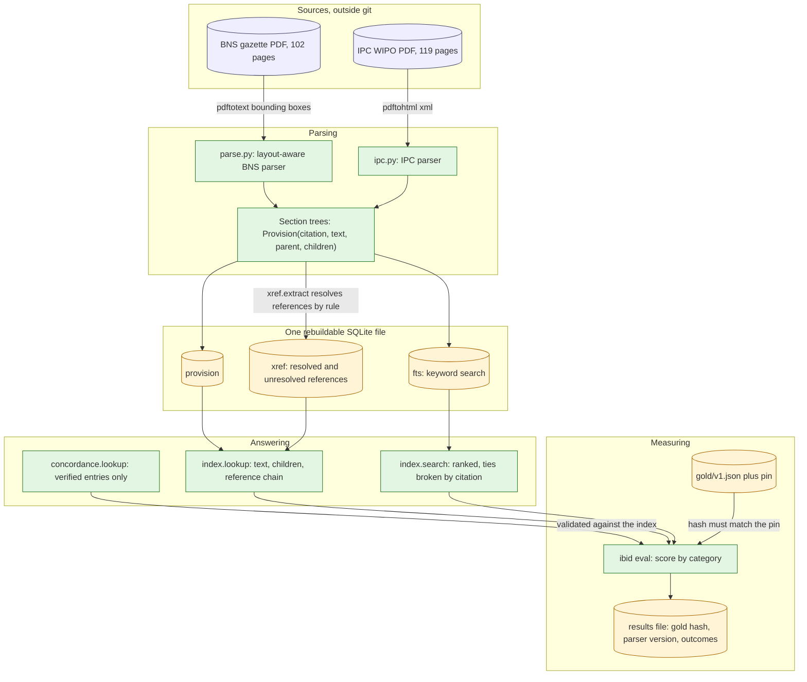

# Architecture

Ibid is a Python library with one command, `ibid`, over one SQLite file ([ADR 0002](adr/0002-python-and-sqlite.md)). Everything is deterministic: the same sources and the same query give the same bytes.

## Data flow

## Modules

| Module | Responsibility |
|---|---|
| `parse.py` | BNS parser, the `Provision` shape, `BNS_TOTAL`, `PARSER_VERSION` |
| `ipc.py` | IPC parser, `IPC_TOTAL`, strips amendment marks and footnote numerals |
| `xref.py` | Finds cross-references by regex, resolves them within one Act, builds per-provision chains |
| `index.py` | Builds the SQLite file, `lookup`, `search`, reference counts |
| `concordance.py` | Loads a concordance file, validates every citation against the index, two-way lookup |
| `cli.py` | `ibid eval`, plus `conform` and `freeze` entry points |
| `conform.py` | Applies the text conventions to drafted gold, with guards |
| `freeze.py` | Applies the review sheet, writes the pinned gold and the concordance |

## Invariants

- **Section counts are exact.** `eval` stops if either Act does not recover its known total.
- **Order is total.** Search ties break by citation, so a result is a fixed sequence.
- **Frozen means frozen.** Scored mode compares the gold file to its pin before parsing anything.
- **Unverified is not served.** A concordance entry with `verified: false` answers "no verified concordance".

## Decisions

See [docs/adr/](adr/) and the vocabulary in [CONTEXT.md](../CONTEXT.md).
