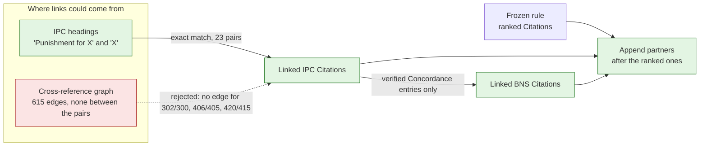

# 0007: Definition and punishment links come from IPC headings, not from the Cross-reference graph

Status: accepted (owner, 2026-10-17, slice 7)

A murder query matches the definition (IPC 300) while the punishment is in IPC 302, and a search for "criminal breach of trust" returns IPC 406 and not the defining IPC 405. Expanding the ranked output with the linked partner fixes both, but the links need a source.

**Why not the Cross-reference graph.** The resolved graph has 615 edges, 586 of them resolved (measured 2026-10-17 on the real Acts, pinned in `tests/test_xref_graph.py`). It has no edge in either direction between IPC 302 and 300, 406 and 405, or 420 and 415. The punishing section does not cite the defining one by number. It uses a defined term ("commits murder"), and a Cross-reference is a section number or a "this section" chain. Expanding over the graph would do nothing for the cases that motivated the slice.

**The rule.** A section headed "Punishment for X" is linked, in both directions, to every other top-level section whose heading equals X after lowercasing and stripping the trailing full stop. Nothing else creates a link: no fuzzy match, no stemming, no section whose heading merely contains X. This gives 23 IPC pairs, among them 302 and 300, 376 and 375, 379 and 378.

The BNS has no headings for most sections. A BNS link is carried through the Concordance: if linked IPC sections A and B have verified entries to BNS a and b, and a differs from b, then a and b are linked. An unverified entry creates no link.

**When it runs.** Expansion runs after ranking. For each predicted Citation, in rank order, its linked partners not already predicted are appended after the originals. The ranking and the Frozen rule are untouched, so the retrieval path still takes the raw query only and [ADR 0001](0001-retrieval-independent-of-the-model.md) holds.

**Cost.** Sections without such a heading are not linked, for example IPC 307 "Attempt to murder", and sub-provisions are not linked. Each expansion adds predictions, so the report states recall next to the mean predictions per item.

**Check.** A test fails if the graph gains an edge between the three pairs or its edge count moves from 615 and 586, so a later change to `xref.py` is noticed rather than silently altering what this ADR rests on.
