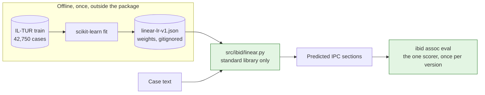

# 0009: A linear layer, trained offline, predicted with the standard library

Status: accepted 2026-10-22 (owner signed `.scratch/slice-13/strategy.md`; decision D-006).

**Decision.** `linear-lr v1` is an opt-in layer, like `assoc-nb` (ADR 0005). It is a one-vs-rest logistic regression on tf-idf unigrams (50,000 features, C=4, one global probability cutoff of 0.15), fitted on the IL-TUR LSI train split. Fitting uses scikit-learn in a throwaway environment (`.scratch/slice-13/export_linear.py`) and writes a JSON weights file. `src/ibid/linear.py` reads that file and predicts with the standard library only, so ADR 0002 holds for everything that ships or runs in Ibid. The baseline path and the frozen rule are untouched (ADR 0001).

**Why.** Term counts with label priors reach 18.3 macro-F1 on IL-TUR dev (`assoc-nb` refit on masked text). Macro-F1 weights every label equally, which a discriminative model with its own scores handles better. Pure-Python training at this size is too slow, so training is allowed outside the package while inference stays inside it.

**Data and licence.** Trained on IL-TUR LSI (CC BY-NC-SA 4.0, no redistribution). The weights file is a derivative, so it stays gitignored and private, like the `assoc-nb` models.

**Limits.** It predicts the 100 IL-TUR labels, which include non-offence sections (2, 3, 34, 149, 120B among them). Its 30 set v1 items are inside its training data, so set v1 is not scored. On layperson text (set v2) it is weaker than `assoc-nb v3`. No lawyer reviewed any label.

**Checks.** The stdlib prediction equals scikit-learn's probabilities to 3e-7 on 300 dev documents with no differing decision, and `ibid assoc eval` on dev reproduces scikit-learn's dev scores.

**Added 2026-10-22 (slice 14).** `ibid ilsic eval` is a second scorer, for ILSIC splits only. It scores the frozen rule and the `assoc-nb` and `linear-lr` model files on the raw `instruction` (ADR 0001), over a fixed label space with zero-label macro averaging, and keeps its own once-per-version ledger, `results/test-ledger-ilsic.json`. `ibid assoc eval` stays the scorer for ILSI and IL-TUR splits. `linear-lr v2` is the same recipe fitted on the original ILSI text (`.scratch/slice-13/strategy.md`), with the same licence (CC BY-NC-SA 4.0, weights gitignored); neither version is fitted on ILSIC.
