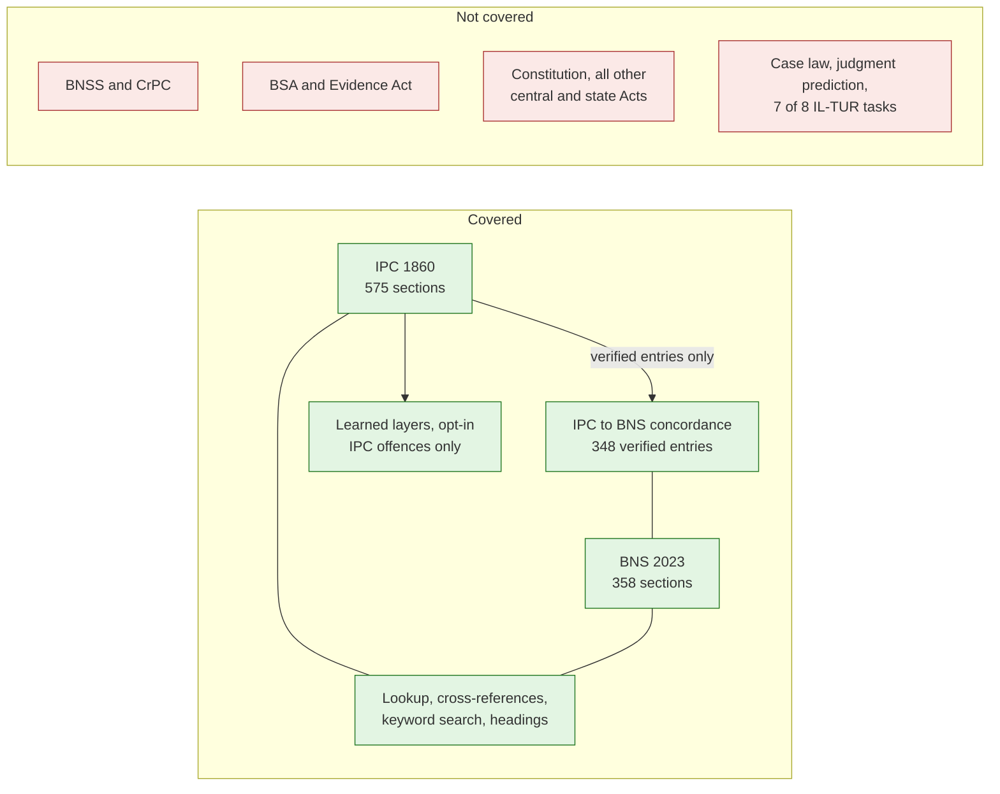

# What Ibid covers, and what it may claim

Last checked 2026-10-22 against the result files named in each row. `tests/test_claims.py` fails if a figure here stops matching its file. Rules for adding a claim are at the end.

## Coverage

| Act | In Ibid | Provisions | Notes |
|---|---|---|---|
| Indian Penal Code, 1860 | yes | 575 sections | 554 have a heading, 21 do not (count by `ibid headings list --act ipc`) |
| Bharatiya Nyaya Sanhita, 2023 | yes | 358 sections | all 358 have a heading, read from the PDF margin |
| IPC to BNS concordance | yes | 402 entries, 348 served | the rest are unverified or have no counterpart; `concordance/v3.json` |
| BNSS, CrPC, BSA, Evidence Act | no | 0 | the next Acts to add |
| Constitution and every other Act | no | 0 | |

| Capability | Status |
|---|---|
| Verbatim text and exact citation for a section or sub-provision | built, no model call |
| Cross-references and the IPC to BNS mapping | built, verified entries only |
| Keyword search on the raw query | built, weak on story-style questions (rows C4 and C6) |
| Learned layers (`assoc-nb`, `linear-lr`) | built, opt-in, IPC offence sections only, research data licences |
| Anything outside the IPC and the BNS | not built |

IL-TUR has eight tasks. Ibid has been scored on one, legal statute identification. The other seven (L-NER, RR, CJPE, BAIL, PCR, SUMM, L-MT) have not been attempted.

## Claims ledger

| ID | Claim, in the words allowed | Evidence | Figure | Limits | Status |
|---|---|---|---|---|---|
| C1 | Ibid returns the verbatim text of any IPC or BNS section with its exact citation, with no model in the retrieval path. | [ADR 0001](adr/0001-retrieval-independent-of-the-model.md), `ibid setup` section counts | 575 IPC, 358 BNS | Two Acts only. Text is parsed from the PDFs; no lawyer checked it. | supported |
| C2 | On the IL-TUR legal statute identification test, `linear-lr v1` scores a macro-F1 above the best baseline in the IL-TUR paper. | `results/test-ledger-iltur-assoc.json`, `results/iltur-lsi-test-linear-lr-v1-stats.json` | macro-F1 39.16, 95% interval 38.37 to 39.80, against 28.08 for LeSICiN | Compared with a published table, not with code we ran. 13,019 of the paper's 13,039 test cases. The paper's macro-F1 averaging is unconfirmed. The leaderboard has no usable entry, and we have not submitted. One look at the test split. | supported with limits |
| C3 | On the original ILSI test, `linear-lr v2` scores a macro-F1 above LeSICiN's 28.45 and above the 35.5 of the AoS paper. | `results/test-ledger-assoc.json`, `results/ilsi-test-linear-lr-v2-stats.json` | macro-F1 59.56, 95% interval 58.75 to 60.21 | Below the 64.58 reported for InLegalBERT, which was measured on text that probably still shows section numbers and was not reproduced. This is not a state-of-the-art claim. | supported with limits |
| C4 | Keyword search alone is weak on story-style text. | `results/test-ledger.json`, `results/test-ledger-iltur.json` | ILSI test micro-F1 9.37, IL-TUR test 9.66 | Describes the frozen rule v2.11 on these two benchmarks only. | supported |
| C5 | On 30 hand-picked layperson multi-charge cases, `assoc-nb v3` finds 58.3% of IPC charges and 65.4% of BNS charges. | `results/multicharge-v2-assoc-v3-ipc.json`, `results/multicharge-v2-assoc-v3-bns.json` | 58.33 and 65.43 | 30 items, 2 or 3 IPC charges each, labels incomplete, no lawyer review. Not comparable with C6. | supported with limits |
| C6 | On the ILSIC layperson benchmark, no Ibid layer reaches the published numbers. | `results/test-ledger-ilsic.json`, `results/ilsic-report.md` | best micro-F1 12.70 on Lay and 14.13 on Multi, against 34.23 and 33.95 published | 37% of the Lay test gold labels are IPC sections; a perfect IPC-only layer would reach about 51 micro-F1. The 543-label count differs from the paper's about 567. | not supported (a negative result) |

## Claims Ibid may not make

"State of the art", unqualified. "The most complete" solution for Indian law, in any wording. Any statement that an answer is legally accurate or reviewed: no lawyer has reviewed any label, mapping or gold set. Commercial or public use of the learned layers: ILSI, ILSIC-Lay and IL-TUR are research data under non-commercial licences, and the model files built from them stay out of git.

## Adding or changing a claim

1. Name the benchmark, split and metric, and the label space.
2. Find the best published number and its source. If two papers disagree, settle why before comparing (see `.scratch/goals/sota-claims.md`).
3. Pre-register the rule, fit on train, choose on dev, take one test look, report an interval.
4. Add a row here with the result file, the figure and the limits, then add the figure to `tests/test_claims.py`.
