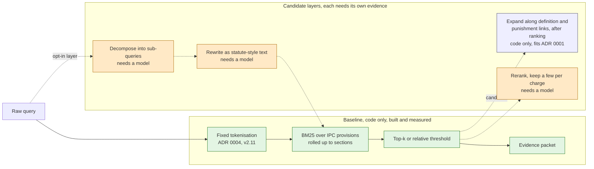

# Legal retrieval literature and what it means for Ibid

Written 2026-10-12, after slice 2. The first version of this note came from a literature summary the owner pasted in. Each claim below says whether it was checked against its source. Numbers marked "not checked" are repeated from that summary and should not be quoted until someone opens the paper.

## Where the ideas fit

Ibid's baseline is code only ([ADR 0001](../adr/0001-retrieval-independent-of-the-model.md)). The literature's best-supported fix for multi-charge queries needs a model. ADR 0001 already allows that as an opt-in layer that must beat the baseline on the gold set and report its own evidence packet.

Green is built. Blue is a code-only candidate. Orange needs a model and therefore an opt-in layer with its own packet.

## Claims and their status

| Claim | Source | Status |
|---|---|---|
| Retrieval is the primary driver of legal RAG performance, more than the LLM | Legal RAG Bench, arXiv 2603.01710 | Abstract checked. 100 questions, 4,876 passages from the Victorian Criminal Charge Book. The "embedding model mattered far more" detail and the vendor interest are not checked. |
| Decomposing and rewriting together beats either alone, F1 58.6 against 46.2, 45.4 and 46.7 | Decompose-and-Refine, arXiv 2605.24454 | Abstract checked: Korean KoBLEX benchmark, Qwen3-32B and Gemma3-27B, no numbers in the abstract. The figures are not checked. |
| One statute per sub-issue beats allowing five (34.5 to 19.5 exact match) | same | Not checked. |
| Predicting statute names as tags adds little (58.6 to 57.7) | same | Not checked. |
| Multi-agent rewriting and an LLM reranker raise Recall@10 from 0.603 to 0.684 on 118 Chinese queries | LegalMALR, arXiv 2601.17692 | Not checked. |
| On the Indian IPC task, KG expansion raised recall and lowered precision. Llama 3.1 8B alone scored micro-F1 7.2, with KG context 5.9 | NyayGraph, NLLP 2025 | Checked against the full paper, Table 7. See below. |
| BM25 hybrid sometimes lowers precision. A commercial reranker sometimes hurts | arXiv 2510.06999, LegalBench-RAG | Not checked. |
| Summary-augmented chunking roughly halves wrong-document retrieval | arXiv 2510.06999 | Not checked. |
| PageIndex has only vendor-reported numbers | PageIndex repository | Not checked. |
| The AILA statute dataset has labels generated automatically from citations | Legal RAG Bench | Not checked. |

## The one directly comparable result

NyayGraph evaluates on the same split Ibid uses: the ILSI test set with 100 IPC labels and 42,835, 10,200 and 13,039 cases. Its Table 7 gives, for Llama 3.1 8B served by Ollama:

| Run | micro-F1 | macro-F1 |
|---|---|---|
| LLM, plain prompt | 7.2 | 4.8 |
| LLM with IPC knowledge-graph context, top 10 | 5.9 | 3.5 |
| Knowledge-graph retrieval only, top 10 | 5.9 | 2.1 |
| Ibid v2.11, threshold rule, test | 9.6 | 6.2 |

Ibid's deterministic retrieval is above an untuned 8B model on both metrics. It is still far below the trained classifiers (28.45 macro-F1). The prompt, sampling settings and metric code of NyayGraph were not reproduced, so this is a reference point, not a ranking. The report ([results/report.md](../../results/report.md)) now carries these rows.

The paper's own conclusion matches the literature note: expansion raised recall and lowered precision, so it belongs after ranking and along a few edge types.

## What slice 2 already tells us

Two measured failures line up with the literature.

- IPC 302 (murder) was found in 4 of 3,246 test cases. A query about murder matches the definition in IPC 300, and the punishment lives in 302. This is the definition and punishment link the note recommends expanding along, and it is a code-only fix.
- IPC 376 was predicted on about three quarters of test cases. Long sections win under the BM25 settings that were best on train. The `levels` and `rollup` knobs exist and were not tried.

## Candidates, not decided

1. A real multi-charge test set of 50 to 100 queries with lawyer-labelled sections, scored for recall per charge. The benchmark's cases are judgments, and the sanitised queries an assistant writes are not realistic. This comes before any model layer, because without it a model layer cannot be shown to beat the baseline.
2. Code-only link expansion after ranking, along definition and punishment edges of the cross-reference graph, tested on the benchmark and the 302 and 300 pair first. It stays inside ADR 0001.
3. The untried baseline knobs (`stem`, `levels`, `rollup`, stop words), under the same protocol, with the single-label guard.
4. A model layer for decomposition, rewriting and reranking, as an opt-in under ADR 0001. It needs a model choice, a cost estimate and its own packet.

Not recommended yet: dense retrieval as a default, graph expansion before ranking, and PageIndex. The evidence for each is mixed or vendor-reported.
